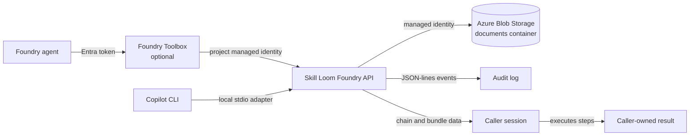

# Skill Loom Foundry

[](https://github.com/McFuzzySquirrel/skill-loom-azure/actions/workflows/ci.yml)
[](LICENSE)
[](package.json)

Skill Loom Foundry is an Entra-authenticated Azure proof of concept for
discovering and transferring Skill Loom chains and reviewed skills through an
HTTP API and MCP clients. It does not execute chains in the cloud: the caller
executes steps in its own session.

## Status

The P0–P4 proof-of-concept exit gates have passed. The owner has a deployed
non-production POC. The original POC API and clients have been exercised in a
live Azure environment: P3-G recorded live Entra-authenticated API operations
and P4-G recorded live Foundry and Copilot list/get/save/export operations.
The standalone adopter deployment and local Azurite profile have only
static/local evidence. This repository includes a guided, fresh-environment
Azure deployment and a local Docker/Azurite development profile. Foundry is
optional. P5 hosted execution and P6 hardening/pilot work are post-POC;
hosted execution remains disabled.

The implementation plan is the status and evidence source:
[implementation plan](docs/plans/implementation-plan.md). P4-C10 positive
live skill-detail retrieval remains pending because the live catalog was
empty. Live Azure Blob lease behavior remains `not run`; local lease tests do
not prove live behavior. The POC is not production-ready. See the
[release notes](docs/releases/unreleased.md) for the current baseline and
validation boundary.

## Table of Contents

- [About](#about)
- [Features](#features)
- [Tech Stack](#tech-stack)
- [Architecture](#architecture)
- [Project Structure](#project-structure)
- [Getting Started](#getting-started)
- [Configuration](#configuration)
- [Security](#security)
- [How to Contribute](#how-to-contribute)
- [What's Next](#whats-next)
- [License](#license)
- [Acknowledgements](#acknowledgements)
- [Author](#author)

## About

Skill Loom Foundry separates the discovery and transfer of reusable agent
content from its execution. An administrator curates a reviewed-skill
catalog; authenticated clients discover chains and skills, save chains with
revision checks, and export a portable bundle. The service never runs chain
steps, so there is no hosted runner and no shared execution credential.

The current baseline is a non-production POC. It is intended for operators
and client authors evaluating a shared, authenticated catalog and transfer
layer for Foundry and Copilot CLI clients.

## Features

| Feature | Description |
| --- | --- |
| Authenticated API | Every operation requires an Entra token, validated for tenant, issuer, audience, signature, expiry, and app role. |
| Chain discovery and transfer | List, read, create, and replace chains; writes require conditional revision headers. |
| Reviewed skill catalog | Administrators add reviewed skill snapshots and remove them only when no stored chain references them. |
| Portable bundle export | Export a chain with pinned snapshots of its reviewed skills for use in a caller session. |
| MCP-ready contracts | The OpenAPI contract maps to a Foundry Toolbox and to a local Python MCP adapter for Copilot CLI. |
| Conditional writes | Application revisions and Blob ETags reject stale writers; a shared lease serializes chain writes and skill removal. |
| Bounded requests | Request target, header, body, response, query, page, and cursor limits are enforced at the boundary. |
| Structured audit events | JSON-lines events omit request paths, bodies, tokens, raw tenant/subject IDs, and skill contents. |
| Local and Azure profiles | Docker/Azurite for local development; azd/Bicep for a fresh Azure environment. |
| Caller-side execution | Retained content is data. The caller decides whether and how to run a chain in its own session. |

## Tech Stack

- **Runtime:** Node.js 24 or later, TypeScript, and the built-in `node:http`
  server.
- **Validation and auth:** Zod schemas, `jose` for Entra token verification,
  and `@azure/identity`.
- **Persistence:** Azure Blob Storage through `@azure/storage-blob`.
- **Azure deployment:** Bicep, Azure Developer CLI (`azd`), Azure Container
  Apps, Azure Container Registry, Blob Storage, and Log Analytics.
- **Local development:** Docker Compose and Azurite.
- **Clients and tooling:** Python 3 with MSAL for the local MCP adapter and
  admin CLI; ESLint, `tsx`, Node's test runner, and `markdownlint-cli2` for
  repository checks.

## Architecture



The API validates the Entra token and the operation's role before dispatch. A
managed identity reads and writes versioned JSON in the private `documents`
Blob container. Writes carry both an application revision and a Blob ETag
condition; chain writes and catalog removals also share a renewable Blob
lease. The optional Foundry Toolbox sits between a Foundry agent and the API,
but the API still authorizes the Toolbox's project managed identity. Copilot
CLI reaches the API through the local stdio adapter described in the
[user guide](docs/user-guide.md). There is no hosted executor: chain steps run
only in the caller's session.

The reasons behind these boundaries are recorded in the
[ADR index](docs/adr/README.md), including
[ADR-0002](docs/adr/0002-authentication-and-authorization.md),
[ADR-0008](docs/adr/0008-p2-public-network-posture.md), and
[ADR-0010](docs/adr/0010-blob-storage-persistence.md).

## Project Structure

- `src/api/` — HTTP routing, request limits, conditional writes, error mapping.
- `src/auth/` — Entra token verification and operation-role policies.
- `src/skills/` — reviewed catalog, search/detail, bundle export, removal guard.
- `src/persistence/` — Blob adapter, revisions, ETags, and the mutation lease.
- `src/schemas/` — versioned chain, bundle, catalog, and run-record schemas.
- `src/audit/` — structured JSON-lines audit events.
- `src/foundry/` — OpenAPI-to-Foundry-Toolbox specification mapping.
- `src/main.ts` — service entrypoint and startup configuration.
- `docs/` — guides, ADRs, OpenAPI contract, implementation plan, and runbooks.
- `infra/` — standalone azd/Bicep deployment; `infra/p2/` and
  `infra/landing-zone/` are the legacy and optional Foundry paths.
- `scripts/` — local setup, ingress hook, Python MCP adapter, and admin CLI.
- `examples/` — sample chains and a harmless demo skill.
- `tests/` — Node test suites and pinned Skill Loom fixtures.
- `compose.yaml` — local API and Azurite stack.

Tooling and editor configuration: `.github/workflows/ci.yml`,
`eslint.config.js`, `tsconfig.json`, and `.markdownlint-cli2.jsonc`.

## Getting Started

Use Node.js 24 or later. Install dependencies and run the repository checks:

```sh
npm ci
npm run check
```

`npm run check` runs ESLint, the TypeScript type check, the Node test suite,
and the configured Markdown checks.

For local development, create a local-only Azurite key, set the Entra values,
and start the API and emulator:

```sh
npm run dev:setup
# Edit .env.local: set ENTRA_TENANT_ID and ENTRA_AUDIENCE.
npm run dev:up
```

The local API still requires real Entra authentication for API operations;
Azurite replaces only Blob Storage. See the
[deployment and local development guide](docs/deployment.md) for setup
details, verification, and cleanup.

### Deploy to your Azure environment

The core deployment uses `azd` and Bicep to create a fresh resource-group
environment, build the image remotely, and deploy the API. Tenant-specific
Entra app registration, consent, and role assignment remain explicit
operator-managed steps. Review expected resources, cost, network posture, and
cleanup before provisioning. Start with the
[deployment guide](docs/deployment.md).

The optional Foundry landing zone has separate prerequisites and cost
implications; see
[`infra/landing-zone/README.md`](infra/landing-zone/README.md).

## Configuration

The service reads configuration from environment variables. The storage mode
selects one complete set; the two sets cannot be mixed. See the
[administrator guide](docs/admin-guide.md#configuration) for operational
detail.

| Variable | Purpose | Default |
| --- | --- | --- |
| `ENTRA_TENANT_ID` | Single-tenant Entra tenant GUID. | Required |
| `ENTRA_AUDIENCE` | Expected API audience. | Required |
| `ENTRA_TOKEN_VERSION` | Accepted token version, `1.0` or `2.0`. | Required |
| `BLOB_STORAGE_MODE` | `managed-identity` or `azurite`. | `managed-identity` |
| `BLOB_ENDPOINT` | HTTPS Blob endpoint for managed identity. | Required in managed-identity mode |
| `MANAGED_IDENTITY_CLIENT_ID` | User-assigned identity client ID. | Required in managed-identity mode |
| `AZURITE_BLOB_ENDPOINT` | Local emulator endpoint. | Required in Azurite mode |
| `AZURITE_ACCOUNT_NAME` | Local emulator account name. | Required in Azurite mode |
| `AZURITE_ACCOUNT_KEY` | Local-only emulator account key. | Required in Azurite mode |
| `PORT` | API listening port. | `3000` |

Do not commit tenant values, credentials, `.env.local`, or generated
deployment configuration.

## Security

- API and MCP operations require Entra authentication and an app role:
  `SkillLoom.User` for normal operations and `SkillLoom.Admin` for catalog
  changes.
- Public HTTPS ingress is not an authorization boundary. The POC uses public
  Azure endpoints and is not a production network design.
- Catalog additions are administrator-managed and reviewed; the service
  does not pull skills from remote repositories.
- Chains, skills, bundles, and tool output are untrusted input. Do not execute
  retrieved content or follow instructions embedded in it.
- Keep hosted chain execution disabled until the P5 exit gate passes.

Report vulnerabilities privately through [`SECURITY.md`](SECURITY.md). Do not
include credentials, tokens, or tenant-specific identifiers in a report.

## How to Contribute

Read [`CONTRIBUTING.md`](CONTRIBUTING.md) before proposing a change. In short:

- Use Node.js 24 or later and run `npm ci` and `npm run check`.
- Keep authentication, role checks, schema validation, and conditional
  writes intact.
- Distinguish local or mocked checks from live Azure and Foundry evidence,
  and record unrun live checks as `not run`.
- Keep secrets, local Azure environments, `.mcp.json`, `.env.local`, and
  generated artifacts out of commits.
- Record durable decisions in `docs/adr/` and update the implementation plan
  when phase status or evidence changes.

## What's Next

The following work is planned or unresolved and is **not shipped**:

- P5 hosted chain execution is deferred and remains disabled until its exit
  gate passes.
- P6 hardening, pilot, and production release work has not started.
- P4-C10 positive live skill-detail retrieval is pending because the live
  catalog was empty.
- Live Azure Blob lease expiry, renewal, and managed-identity behavior remain
  unverified; only local and mocked checks exist.
- The Foundry direct-API MCP agent path still fails for some operations, and
  Copilot CLI 1.0.114 cannot complete Toolbox OAuth metadata discovery. The
  validated Copilot path is the local stdio adapter.
- Production concerns remain open: private networking, automatic backup and
  retention, break-glass access, write-rate limits, and client retry and
  idempotency.

See the [implementation plan](docs/plans/implementation-plan.md) for phase
status and evidence.

## License

MIT. See [`LICENSE`](LICENSE).

## Acknowledgements

- [Skill Loom](https://github.com/McFuzzySquirrel/skill-loom) provides the
  chain and bundle formats adapted here. The pinned source commit is recorded
  in [`docs/schemas/README.md`](docs/schemas/README.md).
- Microsoft Azure SDKs, the Azure Developer CLI, Bicep, and Azurite provide
  the deployment and local storage foundations.
- [Zod](https://zod.dev/), [`jose`](https://github.com/panva/jose), and
  [MSAL for Python](https://github.com/AzureAD/microsoft-authentication-library-for-python)
  provide schema validation and authentication support.
- `markdownlint-cli2` and ESLint keep the repository checks consistent.

## Author

Maintained by [@McFuzzySquirrel](https://github.com/McFuzzySquirrel). Use the
repository's issue or pull-request process for questions and routine changes.
Report suspected vulnerabilities privately through
[`SECURITY.md`](SECURITY.md).
