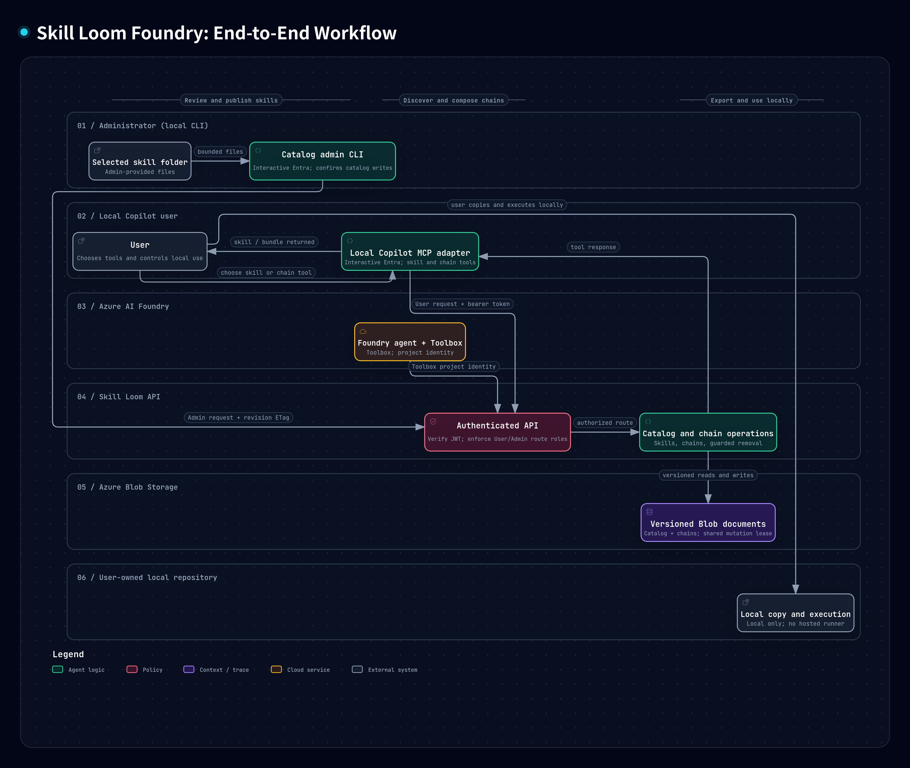
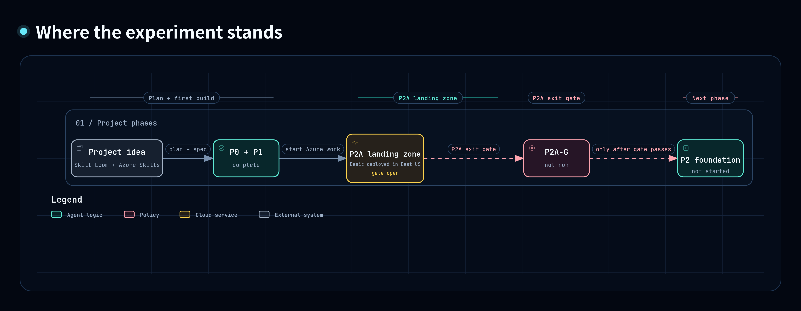
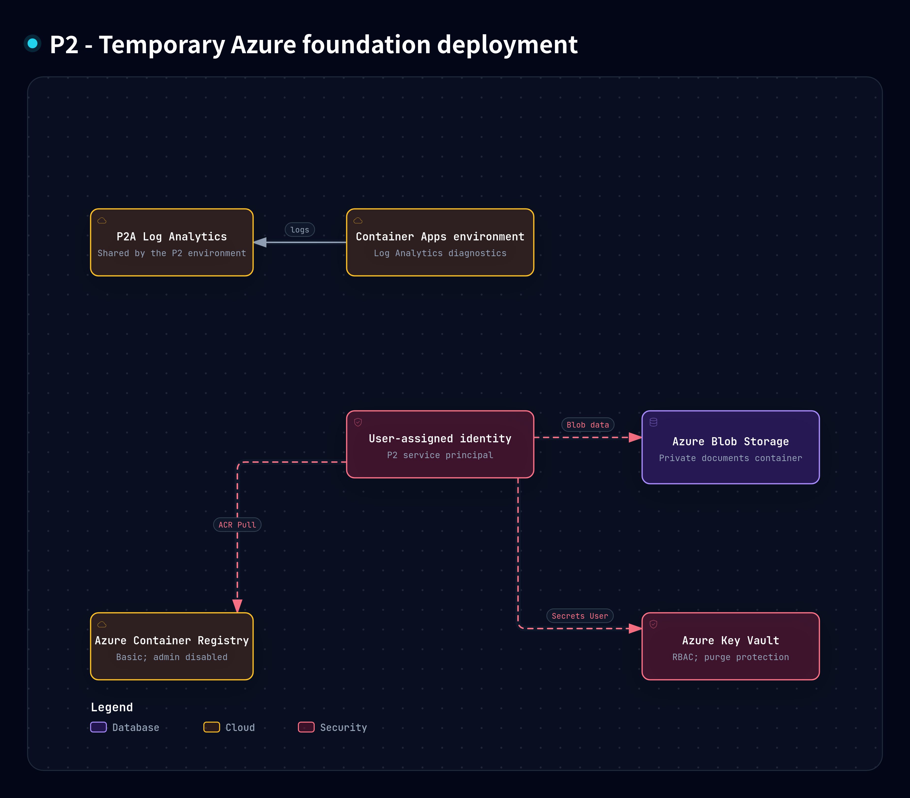
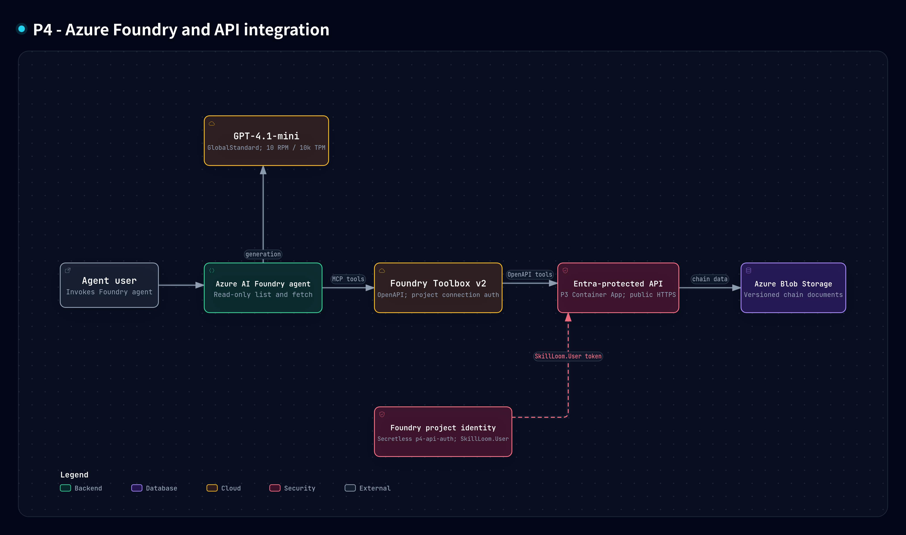

# Microsoft Azure Skills, a plan, and an experiment

This is a running account of building a separate Azure-hosted service around
[Skill Loom](https://github.com/mcfuzzy-squirrel/skill-loom), using GitHub
Copilot CLI and the [Microsoft Azure Skills](https://github.com/microsoft/azure-skills).
The owner selected
[`McFuzzySquirrel/skill-loom-azure`](https://github.com/McFuzzySquirrel/skill-loom-azure)
as the target for the audited public snapshot; the original repository remains
private.
The project owner brings the idea, makes product and deployment decisions, and
handles account-level actions. The GitHub Copilot CLI coding agent researches,
plans, implements, and verifies the work; research sub-agents are identified
when they contribute.

The P0–P4 proof of concept serves chains and reviewed skills through an
Entra-authenticated API and MCP clients; agents run chain steps in their own
sessions. Admin-managed catalog changes are implemented. The owner has
classified hosted execution and hardening/pilot work as post-POC. A standalone
Azure deployment and local Azurite profile are now implemented for adopters;
no Azure resources have been provisioned for these new paths.

## Quick highlights

These tables summarize the skills and tools recorded in the dated phase
entries. Skills and tools are listed separately; the implementation plan
remains the source of truth for phase status.

### Microsoft Azure Skills and tools

| Phase | Skills | Tools | Use |
| --- | --- | --- | --- |
| P0/P1 — Project setup, decisions, and interchange | — | — | No Azure-specific use recorded. |
| P2A — Foundry landing zone | `microsoft-foundry`, `azure-quotas`, `entra-app-registration` | Azure CLI, Azure MCP, `azd` | Provision and verify the Foundry landing zone, quotas, app roles, and teardown. |
| P2 — Azure foundation and storage | `azure-storage`, `azure-quotas`, `azure-resource-lookup`, `entra-app-registration`, `azure-prepare`, `azure-validate`, `azure-deploy` | Azure CLI/Bicep, `azd`, Azure Storage MCP (inventory attempt timed out) | Plan and deploy the storage foundation; test scoped Blob operations and restore. |
| P3 — Authenticated API (serve mode) | `azure-storage`, `entra-app-registration`, `azure-prepare`, `azure-validate`, `azure-deploy` | Azure CLI, `azd`, Bicep, Container Apps and Blob Storage operations | Deploy the API and verify Entra policy, revisions, and live API behavior. |
| P4 — MCP server and Foundry/Copilot integration | `microsoft-foundry`, `microsoft-docs`, `entra-app-registration`, `azure-prepare`, `azure-validate` | Azure Resource Group, ARM, Policy, Foundry, and Monitor MCPs; Azure CLI/`azd`, `curl`; Azure best-practices MCP (`get_azure_bestpractices_get`) | Research and register agents, manage identity, diagnose invocation and telemetry, create/validate Toolbox versions, and guide Azure API implementation. |
| P5 — Hosted runner (Jobs) | — | — | No Azure-specific skills or tools recorded in the P5-C1 authentication review. |
| P6 — Hardening, pilot rollout, release | — | — | Not started. |
| Cross-phase — P0/P1 Project setup, decisions, and interchange; P2A Foundry landing zone; P2 Azure foundation and storage; P3 Authenticated API (serve mode); P4 MCP server and Foundry/Copilot integration; P5 Hosted runner (Jobs); P6 Hardening, pilot rollout, release | `azure-app-onboard` | `ask_user`, CodeGraph, `md-doc-search`, Azure CLI, `azd`, Bicep | Plan and implement a fresh-environment Azure adopter path; no Azure resources provisioned. |

### Other skills and tools

| Phase | Skills | Tools | Use |
| --- | --- | --- | --- |
| P0/P1 — Project setup, decisions, and interchange | `writing-for-agents`, `no-ai-slop`, `archify` | GitHub Copilot CLI plan mode; repository/code tools | Frame the project, edit prose, and produce phase diagrams. |
| P2A — Foundry landing zone | `wizard`, `archify` | `ask_user`; Archify CLI | Guide account-level setup and visualize the Foundry boundary and deployment progress. |
| P2 — Azure foundation and storage | `research`, `tdd`, `archify` | Archify CLI; Microsoft Learn search/fetch, codegraph, `rg`, npm/`npx tsx`, OpenSSL, Node.js/Azure SDKs | Compare storage options; implement and test storage, backup, and restore; diagram the temporary Azure deployment ([snapshot](images/p2---temporary-azure-foundation-deployment.png)). |
| P3 — Authenticated API (serve mode) | `project-execution-journal`, `archify` | Archify CLI; codegraph, npm/TypeScript/ESLint, Podman, Python, `curl` | Implement and test API/container boundaries and live checks; snapshot excluded after local OCR found a tenant-like label. |
| P4 — MCP server and Foundry/Copilot integration | `diagnosing-bugs`, `codebase-design`, `project-execution-journal`, `research`, `microsoft-foundry`, `archify` | Archify CLI and SVG export; Copilot CLI/docs, Microsoft Learn search/fetch, Azure MCP resource-group listing, Azure best-practices MCP (`get_azure_bestpractices_get`), `skillloom-api` MCP, `ask_user`, CodeGraph, Python stdio harness, catalog admin CLI and tests, Node.js/npm, Playwright/Chromium, `md-doc-search`, `rg`, `view`, `apply_patch`, `markdownlint-cli2`, `npm run docs:check`, `git diff --check`, Git and repository tools | Research client behavior, build/test the adapter and local catalog administration, diagnose integration failures, and diagram Foundry/API and end-to-end workflows ([snapshots](images/p4---azure-foundry-and-api-integration.png), [end-to-end flow](images/skill-loom-foundry-end-to-end-workflow.png)). |
| Cross-phase maintenance — P0/P1 Project setup, decisions, and interchange; P2A Foundry landing zone; P2 Azure foundation and storage; P3 Authenticated API (serve mode); P4 MCP server and Foundry/Copilot integration; P5 Hosted runner (Jobs); P6 Hardening, pilot rollout, release | `create-project-documentation`, `writing-for-agents`, `project-execution-journal`, `archify` | Archify CLI, codegraph, `md-doc-search`, `glob`, `rg`, `view`, `apply_patch`, Python XML parsing, `markdownlint-cli2`, `npm run docs:check`, `git diff --check`, repository tools | Maintain this article and agent guidance, document phase-specific Azure deployments, and validate article and image artifacts. |
| P5 — Hosted runner (Jobs) | `project-execution-journal` | CodeGraph, GitHub Docs (`web_fetch`), repository tools | Review Copilot CLI job authentication; owner deferred hosted execution and keeps personal account local. |
| P6 — Hardening, pilot rollout, release | — | — | Not started. |
| Cross-phase — P0/P1 Project setup, decisions, and interchange; P2A Foundry landing zone; P2 Azure foundation and storage; P3 Authenticated API (serve mode); P4 MCP server and Foundry/Copilot integration; P5 Hosted runner (Jobs); P6 Hardening, pilot rollout, release | `project-execution-journal` | `ask_user`, CodeGraph, `md-doc-search`, Git, `view`, `apply_patch` | Record the owner's POC/adopter decisions and update the implementation plan without provisioning Azure resources. |
| Cross-phase implementation — P0/P1 Project setup, decisions, and interchange; P2A Foundry landing zone; P2 Azure foundation and storage; P3 Authenticated API (serve mode); P4 MCP server and Foundry/Copilot integration; P5 Hosted runner (Jobs); P6 Hardening, pilot rollout, release | `azure-app-onboard`, `project-execution-journal`, `archify` | Azure CLI/Bicep, `azd`, Node.js/npm, Docker/Podman Compose, Git, `git-filter-repo`, GitHub CLI (`gh`), Gitleaks, Tesseract.js, `markdownlint-cli2`, CodeGraph, `md-doc-search`, `web_fetch`, Bash, Python, `rg`, `view`, `apply_patch` | Implement and statically validate adopter-facing Azure/local development paths; scan the public candidate and history; maintain evidence. No Azure resources provisioned. |

## End-to-end workflow

The flow shows the reviewed-skill admin path, authenticated local and Foundry
clients, API and Blob operations, and user-directed local transfer. It does not
depict hosted execution: P5 remains deferred.

The [implementation plan](../plans/implementation-plan.md) remains the detailed
checklist and execution evidence register. This article is the shorter,
phase-based account of the decisions, collaboration, surprises, and lessons.

## How to read the dialogue

- **Project owner** identifies decisions, approvals, and actions taken by the
  requester.
- **GitHub Copilot CLI coding agent** identifies agent research,
  implementation, or verification.
- **Research sub-agent** identifies delegated source research; it does not
  imply that the sub-agent changed Azure resources.
- **Skills used** names skills invoked for the work. **Tools used** names
  commands, CLI/MCP calls, libraries, or editing tools; tools are not skills.
  “None” means no skill was used for that update.
- Local tests and static checks are not presented as live Azure verification.
  Environment-specific values and the approved Entra audience are kept out of
  this public narrative.

Future dated updates should be added to the relevant phase in chronological
order. Preserve who decided or acted, the skills and tools used, and the
boundary between verified behavior and work that remains unrun.

## Experiment setup

Skill Loom is a single-user workspace for building shared chains from skills
installed in a host-global `.agents/skills` directory. Its CLI and companion
Agent Skills find and save ordered workflows, copy selected packages into a
project when needed, and run steps in the current agent session. This cloud
project is separate: it does not expose or reconfigure Skill Loom's
local-trust server.

The project repository is
[`McFuzzySquirrel/skill-loom-foundry`](https://github.com/McFuzzySquirrel/skill-loom-foundry).
The experiment follows a familiar plan/spec/implement approach, with Azure
Skills involved from the start.

## Phase dialogue

The diagrams below are evidence-backed snapshots of the Azure architecture at
each deployment phase, not live inventory. P0/P1 had no Azure deployment; the
P2A illustration is omitted from this candidate; P2 captures a temporary
validation deployment that was removed; the P3 snapshot is omitted after local
OCR found a tenant-like label; and P4 adds the Foundry integration. P5 and P6
have no deployed architecture yet.

### P0/P1 — Project setup, decisions, and interchange

#### Initial framing — November 2026

**Project owner:** Brought the Skill Loom hosting idea and selected the
plan-first, staged approach. The intended first slice is an authenticated
serve-mode API, not an Azure-hosted chain executor.

**GitHub Copilot CLI coding agent:** Helped shape the implementation plan and
separate this service from the existing Skill Loom repository. The cloud
project owns its schemas; compatibility is checked at exported chain and
bundle formats through pinned fixtures.

**Skills used:** `writing-for-agents` and `no-ai-slop` helped shape this
article; `archify` produced the phase diagrams. Azure-specific skills used
during landing-zone planning are recorded in P2A below.

**Tools used:** GitHub Copilot CLI plan mode and repository/code tools. The
article's diagrams are snapshots, not a live view of Azure.

### P2A — Foundry landing zone

_The P2A architecture illustration is omitted; no sanitized replacement is
included in this candidate._

#### Landing-zone choices — 18–19 November 2026

**Project owner:** Chose the Basic Foundry setup, selected an available
model and region, and chose an advisory subscription budget alert. The alert
is not a spending cap. The owner added normal-user and administrator test
identities and accepted a documented break-glass exception for the PoC only.

**GitHub Copilot CLI coding agent:** Checked provider and quota availability,
provisioned the pinned template, ran a tool-free smoke agent, and registered
the single-tenant API app and its `SkillLoom.User` and `SkillLoom.Admin`
roles. The smoke prompt succeeded with Entra authorization and no API key.
The agent found that the normal caller initially had a broader account-scope
role, added and verified the project-scoped assignment, then removed the
broader assignment. Admin remained unassigned.

**Skills used:** Microsoft Azure Skills `microsoft-foundry`,
`azure-quotas`, and `entra-app-registration`; `wizard` guided account setup.

**Tools used:** Azure CLI and Azure MCP calls for setup and checks, plus the
CLI's ask-user tool for decisions. The progress diagrams were produced with
`archify`.

#### P2A gate and teardown — 20 November 2026

**Project owner:** Authorized teardown of the then-current landing zone.

**GitHub Copilot CLI coding agent:** Used `azd down`, purged the exact
soft-deleted Foundry account, and verified the API registration and budget
remained while the deleted Foundry identity's role assignment was absent.
This completed P2A-C11 and P2A-G. The landing zone was later reprovisioned
under separate approval for P2 validation.

**Skills used:** None.

**Tools used:** `azd`, Azure CLI, and the ask-user tool; no resource-changing
Azure MCP request was used for teardown.

The break-glass exception remains a PoC limitation, not production approval.
P2A-G verifies the landing-zone workflow; it does not verify the later API's
authentication.

### P2 — Azure foundation and storage

_Historical deployment snapshot: the P2 foundation was deployed and
restore-tested, then removed; the P2A landing-zone resources remained.*

#### Storage and infrastructure decisions — 19 November 2026

**Project owner:** Chose Bicep, public HTTPS ingress for the future API with
mandatory Entra validation, and public Storage and Key Vault endpoints using
Entra/RBAC for the cost-first PoC. The owner selected Blob as the only PoC
backend, set a 32 MiB maximum serialized object size, chose manual
export/restore only, and skipped throughput benchmarking without a write-rate
target.

**Research sub-agent:** Compared Blob with Azure Files and recommended Blob
with ETag conditional writes. Its first note misstated Azure Files Rename
File's NFS support; the coding agent checked Microsoft's protocol table and
corrected the research note.

**GitHub Copilot CLI coding agent:** Inspected schemas, implemented the
32 MiB serialized-object limit, and recorded the Bicep, recovery, and storage
decisions. Versioning, soft delete, scheduled backup, and automatic retention
remain disabled for the PoC.

**Skills used:** `research`, `azure-storage`, and `tdd`.

**Tools used:** Microsoft Learn search/fetch, codegraph, ripgrep, Azure CLI
Bicep commands, and npm checks. The sizing change had local boundary,
overflow, Unicode-byte-count, and fixture tests; it was not a live Azure
storage test.

#### Blob spike and final backend choice — 20 November 2026

**Project owner:** Approved reprovisioning the landing zone and one disposable
Blob test account, then selected Blob only after reviewing the live results.
The owner left the write-rate target unset and kept backup/restore manual.

**GitHub Copilot CLI coding agent:** Used an Entra-authenticated JavaScript
SDK runner with a container-scoped data role. B1–B7 and X1 passed; B8 lease-ID
checks passed, but lease expiry/renewal were not run. B9 managed-identity
hosting and B10 application retry/idempotency remained deferred. The
disposable storage account and test data were deleted after testing.

**Skills used:** `azure-storage`, `tdd`, and `entra-app-registration`.

**Tools used:** `azd`, Azure CLI/Microsoft Graph,
`@azure/storage-blob`, `@azure/identity`, and the ask-user tool. The Azure
Storage MCP inventory request timed out; no MCP call changed resources.

#### Temporary P2-G deployment, restore, and teardown — 20 November 2026

**Project owner:** Authorized a temporary what-if, foundation deployment,
synthetic Blob restore test, and teardown. The owner approved a
P2-G-only exception to leave purge protection off for an empty test Key Vault
that would be purged after teardown.

**GitHub Copilot CLI coding agent:** Completed validation before deployment.
The detailed what-if showed 10 P2 resources created, five existing P2A
resources ignored, and no modifications or deletions. The agent deployed the
foundation, verified scoped service-identity roles, uploaded a synthetic
schema-valid chain using conditional writes, encrypted and checksummed a
backup outside the repository, and restored and validated it. The temporary
operator role was removed.

The Container Apps environment initially remained `ScheduledForDelete` after
the CLI reported deletion success. With no associated customer VNet to
remove, the agent used the exact ARM resource identifier; a follow-up read
returned `ResourceNotFound`. The P2-G resources were gone and the P2A
resources remained. This sequence is why the plan records post-delete
verification, not just a successful CLI message.

**Skills used:** `azure-prepare`, `azure-validate`, `azure-deploy`,
`azure-storage`, `azure-quotas`, `azure-resource-lookup`, and
`entra-app-registration`.

**Tools used:** Azure CLI, `azd`, Microsoft Learn, `npx tsx`, OpenSSL for
local backup encryption, ask-user confirmations, and `apply_patch`. Some
Azure MCP inventory/list requests timed out; read-only CLI fallbacks
succeeded.

### P3 — Authenticated API (serve mode)

P3 delivers an authenticated API for chains and reviewed skills. P3-C1 through
P3-C6 and P3-G are complete to their recorded boundaries.

_P3 deployment snapshot omitted from this candidate after local OCR found a
tenant-like label; no sanitized replacement is available._

_Recorded non-production deployment snapshot; this article update did not query
live Azure inventory.*

#### Contract and core services — 21 November 2026 (P3-C1 through P3-C4)

**Project owner:** No new deployment authorization was part of these local
implementation steps. The existing plan and security decisions bounded the
work; for P3-C2, the owner explicitly asked the coding agent to finish the
operation-level authorization policy.

**GitHub Copilot CLI coding agent:** Drafted the OpenAPI contract; implemented
the Entra verifier and per-operation role gate; added versioned Blob
persistence with conditional revisions; and implemented the Admin-reviewed
skill catalog and pinned bundle snapshots. Local tests cover auth policy,
stale writes, schema validation, bounded pagination, catalog review, safe
paths, content limits, and bundle snapshots. No HTTP handler or live Entra
or Blob operation was proved by those earlier tests.

**Skills used:** `azure-storage` for Storage guidance; none for the contract,
authentication, or catalog implementation.

**Tools used:** codegraph, Microsoft Learn search, `npm run check`,
`apply_patch`, and local tests with generated RSA keys, an in-memory JWK set,
and fake Blob containers. These do not replace live Entra/JWKS or Blob
verification.

#### Request safety and local container checks — 21 November 2026 (P3-C5/C6)

**Project owner:** Asked the coding agent to complete P3-C5 and P3-C6 and
keep the dated dialogue current.

**GitHub Copilot CLI coding agent:** Connected the auth gate, Blob adapter,
and reviewed catalog to a native HTTP server. The API bounds request targets,
headers, request/response JSON, query parameters, page size, cursors, search
text, and timeouts. Conditional headers protect writes. JSON-lines audit
events omit paths, queries, tokens, bodies, raw actor identifiers, and skill
content. Local tests cover these boundaries and probe/auth separation.

`npm run check` passed with 36 tests; `npm run build`, local container build,
non-root inspection, health probes, and Bicep checks passed. The local image
ran as UID/GID `10001:10001`; its probes returned `204`, and unauthenticated
`/v1/health` returned `401`. At this point no Azure resources were deployed
for P3-C6 and P3-G remained unrun.

**Skills used:** None.

**Tools used:** codegraph, `npm run check`, `npm run build`, Podman,
`curl`, Azure CLI Bicep build/lint, and `apply_patch`.

#### P3-C6 — Deployment approval, image correction, and checks (21 Nov 2026)

**Project owner:** Approved recreating the P2 foundation, publishing the API
image, and deploying an externally reachable HTTPS Container App. The owner
confirmed the previously approved subscription and region and supplied the
non-secret Entra audience. The audience and local deployment parameters are
not reproduced here.

**GitHub Copilot CLI coding agent:** Validated and deployed the foundation,
checked scoped RBAC and retained P2A resources, then built and pushed a
digest-pinned API image. The first image was `linux/arm64`; Container Apps
requires `linux/amd64`, so its first revision failed. The agent changed the
Dockerfile to build for `$TARGETPLATFORM`, rebuilt the image for AMD64, and
revalidated before incrementally updating the failed app resource rather than
deleting it. The final revision is healthy; successful startup with the
private ACR image confirms managed-identity image pull. The foundation has
Key Vault purge protection enabled; the temporary P2-G exception did not
carry forward.

The subscription-list MCP request timed out; the CLI fallback and owner
reconfirmation were used. Live HTTPS checks returned `204` for
`/_health/live` and `/_health/ready`; `/v1/health` returned `401` without an
Authorization header. No bearer token was sent. This verifies probes and
anonymous rejection, not successful Entra authentication.

**Skills used:** `azure-prepare`, `azure-validate`, `azure-deploy`, and
`entra-app-registration`.

**Tools used:** ask-user, Azure CLI, Podman, Bicep build/lint and what-if,
`curl`, Azure role/revision checks, and `apply_patch`. The local `.azure`
deployment plan contains environment-specific execution details and is not
part of this article.

**P3-G remains open:** A deployed wrong-audience request returned `401`, but
positive API-audience authentication, live Blob data operations, and deployed
stale-revision, traversal, and oversize cases have not run. Local or mocked
tests are not recorded as live proof.

#### P3-G — Wrong-audience rejection check — 22 November 2026

**Project owner:** Authorized live P3-G checks against the deployed PoC API.

**GitHub Copilot CLI coding agent:** Tried to acquire an API-audience token;
Entra returned `AADSTS65001` for missing consent. A valid management-audience
token was rejected by the API with `401`; unauthenticated health also
returned `401`, and readiness returned `204`. The first wrong-audience request
timed out after 30 seconds; after readiness confirmed the service was
responsive, the retry returned `401`. No positive API token was obtained, so
no Blob-backed write/read, stale-revision, traversal, or oversize test ran.
No token was logged or retained, and no consent or Azure resource changes
were made.

**Skills used:** `project-execution-journal` and `azure-storage`.

**Tools used:** Azure CLI, Python `urllib`, ask-user, codegraph, and
`apply_patch`. Azure Storage MCP was used only to discover supported commands;
no storage data operation was invoked.

**Evidence limits:** The wrong-audience rejection proves a negative response,
not successful API authentication or Blob access. The positive token and
remaining P3-G checks are blocked until an approved caller can obtain the API
audience token.

#### P3-G — Test-client credential attempt — 22 November 2026

**Project owner:** Confirmed the test client has the `SkillLoom.User`
application role and made its client credential available locally. No
credential values or path are recorded.

**GitHub Copilot CLI coding agent:** Restricted the credential file from
group-readable mode `664` to owner-only `600`. The client-credentials token
request returned `AADSTS700016`; the token endpoint issued no token, so no
authenticated API request followed. A directory lookup did not verify the
client in the active tenant. No credential content was logged or retained.

**Skills used:** `project-execution-journal` and `entra-app-registration`.

**Tools used:** Azure CLI, Python `urllib`, `stat`, `chmod`, and
`apply_patch`.

**Evidence limits:** The app ID or selected tenant may be incorrect, but the
available lookup did not establish which. Confirm the test client is present
in the API's tenant and that the credential file contains that client's
application ID before retrying.

#### P3-G — Test-client token version mismatch — 22 November 2026

**Project owner:** Corrected the local credential file after the initial
client lookup failure and confirmed the test client's `SkillLoom.User`
application role.

**GitHub Copilot CLI coding agent:** Acquired an app-only token without
printing or retaining it. Its audience and `SkillLoom.User` role matched, but
the token had `ver: 1.0` and the v1 STS issuer; the deployed API is configured
for v2 issuer validation. The token was not sent to the API, and no API or
Blob operation ran. No credential contents or path are recorded.

**Skills used:** `project-execution-journal` and `entra-app-registration`.

**Tools used:** Azure CLI, Python `urllib`, codegraph, and `apply_patch`.

**Evidence limits:** Positive API authentication remains unverified. The
owner must decide whether to configure the API registration to issue v2
tokens or change and redeploy the API to accept the current v1 token format.

#### P3-G — v2 token policy decision — 22 November 2026

**Project owner:** Selected v2 token validation and reconfirmed the existing
subscription and East US target.

**GitHub Copilot CLI coding agent:** Recorded the approved alignment:
configure the API resource application to issue v2 access tokens, change the
local API audience parameter to the API Application (client) ID, and retain
the API's v2 issuer policy. No Azure resource or app registration change has
been made yet; validation and deployment are pending.

**Skills used:** `project-execution-journal`, `entra-app-registration`,
`azure-prepare`, and `azure-validate`.

**Tools used:** Microsoft Learn search/fetch, ask-user, codegraph, and
`apply_patch`.

**Evidence limits:** This is an approved configuration plan, not evidence
that the manifest or deployed API has changed. P3-G remains open.

#### P3-G — v2 token-alignment validation — 22 November 2026

**GitHub Copilot CLI coding agent:** `npm run build`, API Bicep lint,
resource-group validation, and Azure Policy checks passed. The first
validation-helper attempt failed because `management.azure.com` did not
resolve; DNS/HTTPS reachability recovered and the retry passed. The helper
summary (Create 3, Modify 20, Delete 6) disagreed with detailed ARM output:
the root `changes` collection showed one modification to the existing API
Container App and ten ignored resources, with no creates or deletes. A
separate optional `potentialChanges` query failed; the root `changes` query
succeeded. Static review confirmed the service identity's Blob, ACR, and Key
Vault roles are scoped to their required resources.

**Skills used:** `project-execution-journal` and `azure-validate`.

**Tools used:** `npm`, Azure CLI, `bash`, `getent`, `curl`, codegraph, and
`apply_patch`.

**Evidence limits:** Validation and static RBAC review are not deployment or
live role-assignment evidence. The Entra app manifest and deployed API remain
unchanged; positive API authentication and the remaining P3-G Blob, stale
revision, traversal, and oversize checks have not run.

#### P3-G — API resource token version — 22 November 2026

**Project owner:** The previously approved v2 alignment authorized changing
the API resource application's token-version setting.

**GitHub Copilot CLI coding agent:** Verified the target application was
`skill-loom-foundry-api` and its `requestedAccessTokenVersion` was unset. The
first update attempt used unsupported generic `--set` property syntax and
made no change. The Azure CLI's dedicated
`--requested-access-token-version 2` option succeeded; a read-back confirmed
the setting is now `2`. No credential or token was used or logged.

**Skills used:** `project-execution-journal` and `azure-deploy`.

**Tools used:** Azure CLI, `apply_patch`, and `view`.

**Evidence limits:** This confirms only the Entra resource-app setting. The
validated API Container App configuration has not been deployed, and no
positive API authentication or Blob operation has run.

#### P3-G — v2 API deployment and positive authentication — 22 November 2026

**GitHub Copilot CLI coding agent:** Deployed the validated API configuration
after setting the resource application's token version to v2. The latest
revision became Healthy/Provisioned and received all ingress traffic.
Liveness/readiness returned `204`; anonymous `/v1/health` returned `401`.
Live role checks found ACR Pull, Storage Blob Data Contributor, and Key Vault
Secrets User at their intended scopes. Using the owner-only local client
credential (mode `600`), acquired a v2 token; its audience, issuer, tenant,
expiry, and `SkillLoom.User` role matched policy. Authenticated
`GET /v1/health` returned `200`. The credential and token were never logged
or retained.

**Skills used:** `project-execution-journal` and `azure-deploy`.

**Tools used:** Azure CLI, Python `urllib`, `curl`, `apply_patch`, and `view`.

**Evidence limits:** The positive check was a read-only API request, not
evidence of Blob writes. Stale-revision, traversal, oversize, and Blob-backed
write checks remain not run. No API delete endpoint exists; these checks are
paused until the owner decides whether to leave a uniquely named test record
or authorize separate Blob cleanup.

#### P3-G — live Blob and edge-case checks — 22 November 2026

**Project owner:** Chose to leave one uniquely named P3-G test record in Blob
Storage; no separate cleanup is authorized.

**GitHub Copilot CLI coding agent:** Created a test chain using the
authenticated API (`201`, ETag `"1"`) and read it back (`200`). A stale
revision update returned `412`; an encoded traversal lookup returned `404`;
an oversized declared request body returned `413`. A final read confirmed the
record remains at revision 1. No chain was executed, and the credential and
token were not logged or retained.

**Skills used:** `project-execution-journal`.

**Tools used:** Azure CLI, Python `urllib`/`http.client`, `apply_patch`, and
`view`.

**Evidence limits:** The checks exercised the deployed API and its managed
Blob persistence, not direct storage-account access. The test record remains
because the API has no delete endpoint and the owner selected retention.

### P4 — MCP server and Foundry/Copilot integration

_This 23 November snapshot shows the separate read-only Foundry agent.
The full-smoke agent later passed P4-G on 24 November (E-161).*

#### P4-C1 — Foundry MCP registration and transport research — 22 November 2026

**GitHub Copilot CLI coding agent:** Current Microsoft documentation confirms
three registration patterns: a custom remote MCP connection, an Azure API
Center organizational tool catalog, and a Foundry Toolbox. Foundry agents
connect to remote endpoints using a unique `server_url` and `server_label`;
`allowed_tools` can restrict exposure, and `require_approval` defaults to
`always`. Hosting guidance requires HTTP POST/GET for Container Apps and
streamable HTTP with chunked transfer for Azure Functions. Entra
authentication can use a per-agent identity or a project managed identity
shared across agents.

**Recommendation at research time:** A custom MCP connection minimizes
infrastructure for a single PoC; API Center and Toolboxes add shared
discoverability, governance, or reuse. The owner selected a Toolbox in a
subsequent decision entry.

**Sources:** [Connect agents to MCP servers](https://learn.microsoft.com/azure/foundry/agents/how-to/tools/model-context-protocol),
[Build and register an MCP server](https://learn.microsoft.com/azure/foundry/mcp/build-your-own-mcp-server),
and [MCP tool authentication](https://learn.microsoft.com/azure/foundry/agents/how-to/mcp-authentication).

**Skills used:** `project-execution-journal`, `microsoft-docs`, and
`microsoft-foundry`.

**Tools used:** Microsoft Learn search/fetch, `bash`, `rg`, `view`, and
`apply_patch`.

**Evidence limits:** This is documentation research only. No MCP server,
Foundry connection, agent, or Copilot integration was created or tested.
Transport and authentication behavior must still be verified in the selected
hosting and Foundry setup.

#### P4-C1 — Foundry Toolbox selection — 22 November 2026

**Project owner:** Selected a Foundry Toolbox as the P4 registration surface.

**GitHub Copilot CLI coding agent:** Recorded the decision in the
implementation plan. No Toolbox, MCP server, Foundry connection, or Azure
resource was created.

**Skills used:** `project-execution-journal`.

**Tools used:** `ask_user` and `apply_patch`.

**Evidence limits:** This records the registration choice only; P4-C2 tool
mapping, authentication, and remote endpoint work remain.

#### P4-C2 — Toolbox OpenAPI compatibility research — 22 November 2026

**GitHub Copilot CLI coding agent:** Reviewed current Foundry OpenAPI Toolbox
and authentication guidance against the existing API contract. Foundry accepts
OpenAPI 3.0/3.1 tools in a Toolbox; `docs/openapi.json` is OpenAPI 3.1.1 and
its operation IDs meet the documented naming constraint. The Toolbox can call
the API using the Foundry project's managed identity, which already has
`SkillLoom.User`. The `SkillLoom.Admin` operation must not be included without
an approved Admin identity. The Toolbox endpoint has a separate Entra
authentication boundary for its clients.

The API already bounds chain objects at 32 MiB and exported bundles at 20 MiB.
Those finite limits may still be too large for model context. Choosing direct
OpenAPI tools versus a thin MCP adapter with a smaller output cap remains open.
The initial dependency-check command targeted the parent
plugin directory and could not find the script; rerunning it from the
Microsoft Foundry skill directory passed and confirmed the dependencies are
ready. No Toolbox, connection, or Azure resource was created.

**Sources:** [Connect agents to OpenAPI tools](https://learn.microsoft.com/azure/foundry/agents/how-to/tools/openapi)
and [Toolbox authentication](https://learn.microsoft.com/azure/foundry/agents/how-to/tools/tool-authentication).

**Skills used:** `microsoft-foundry`, `microsoft-docs`, and
`project-execution-journal`.

**Tools used:** Azure Foundry tool discovery, Azure AI application best-practice
lookup, Microsoft Learn search/fetch, codegraph, `bash`, `rg`, and `view`.

**Evidence limits:** Documentation and local contract review only. No
Toolbox registration, downstream API call through a Toolbox, direct Copilot
authentication, or model-context size test ran.

#### P4-C2 — Direct OpenAPI Toolbox decision — 22 November 2026

**Project owner:** Selected direct OpenAPI tools inside the Foundry Toolbox,
keeping the existing API size limits for the cost-first PoC.

**GitHub Copilot CLI coding agent:** Recorded the decision. The OpenAPI tool
mapping will exclude the Admin-only operation; the Toolbox's project managed
identity will call the API with `SkillLoom.User`. No custom MCP adapter or
smaller tool-specific response cap is planned.

**Skills used:** `project-execution-journal`.

**Tools used:** `ask_user` and `apply_patch`.

**Evidence limits:** This is an implementation decision, not a deployed
Toolbox or live authentication result. The API contract must still be filtered
and validated before registration.

#### P4-C2 — User-scoped OpenAPI mapping implementation — 22 November 2026

**GitHub Copilot CLI coding agent:** Added a reusable OpenAPI mapping helper
that replaces the placeholder server with a validated HTTPS origin and keeps
only operations whose API role policy includes `SkillLoom.User`. This excludes
the Admin-only skill-add operation while preserving the API's bearer security,
schemas, and operation IDs. Documented the existing 32 MiB serialized-object
and 20 MiB decoded-bundle limits. Corrected the OpenAPI security description:
the v2 token's `aud` claim is the API client ID, while the requested scope is
`api://<application-id>/.default`.

**Outcome/evidence:** The targeted OpenAPI contract tests, build, typecheck,
ESLint, article Markdown lint, and `git diff --check` passed. A broader
markdownlint run over the plan and article reported 208 MD013 line-length
issues; the article-only check passed after shortening the new heading. The
plan's one-line evidence table was not broadly reformatted. No Foundry
registration or live Toolbox API call ran.

**Skills used:** `microsoft-foundry` and `project-execution-journal`.

**Tools used:** `apply_patch`, `bash`, `codegraph`, `eslint`, `markdownlint`,
`npm test`, `tsc`, `rg`, and `view`.

**Evidence limits:** Local contract and schema checks do not prove that Foundry
accepts every schema feature or that the project managed identity can call the
deployed API through a Toolbox. Those checks remain for P4-C4.

#### P4-C3 — Client identity boundaries documented — 22 November 2026

**GitHub Copilot CLI coding agent:** Updated the user and administrator guides
to reflect the deployed P3 API and document the distinct identity boundaries.
Foundry's OpenAPI Toolbox connection calls the API as the shared project
managed identity with `SkillLoom.User`; the Toolbox endpoint itself requires
separate Entra authentication for its clients. A direct Copilot CLI caller
needs a Foundry-audience bearer token, while the API still sees the project
identity. The guides explicitly leave Copilot token refresh and direct
Toolbox compatibility unverified and prohibit persisting access tokens in
workspace configuration.

**Sources:** [Connect agents to OpenAPI tools](https://learn.microsoft.com/azure/foundry/agents/how-to/tools/openapi),
[Toolbox authentication](https://learn.microsoft.com/azure/foundry/agents/how-to/tools/tool-authentication),
and the Copilot CLI 1.0.114 MCP documentation.

**Skills used:** `microsoft-foundry`, `microsoft-docs`, and
`project-execution-journal`.

**Tools used:** Microsoft Learn search/fetch, Copilot CLI documentation lookup,
`apply_patch`, `rg`, and `view`.

**Evidence limits:** This is documentation based on current product guidance.
Markdown lint passed. No token was acquired or stored, and no direct Copilot
or Foundry Toolbox request was tested. P4-C5 must verify a safe token-refresh
configuration.

#### P4-C4 — Toolbox registration and blocked smoke invocation — 22 November 2026

**Project owner:** Asked to continue execution of the implementation plan;
the earlier Toolbox and direct-OpenAPI decisions remained in force.

**GitHub Copilot CLI coding agent:** Registered Toolbox `skillloom-api`
version 1 from the User-role-filtered OpenAPI contract, added the
project-managed-identity connection `p4-toolbox-auth`, and created the
read-only prompt agent `p4-chain-smoke` with only list/fetch tools allowed.
Read-back confirmed the Toolbox version is the default and the Foundry project
identity has `SkillLoom.User` on the API. Microsoft guidance requires Foundry
User for the prompt agent's runtime identity; no such role is assigned to the
new agent identity, and the project identity has no project-scoped Foundry
User assignment.

Foundry MCP invocation returned 404 for the new agent and for the existing
P2A smoke agent. A direct Responses API attempt failed during TLS negotiation
through the local proxy. No Toolbox operation reached the API, and no chain
was listed or fetched. Role assignments were not changed.

**Skills used:** `microsoft-foundry`, `microsoft-docs`, and
`project-execution-journal`.

**Tools used:** Azure Foundry MCP, Azure CLI/Microsoft Graph, `azd`, Microsoft
Learn search/fetch, Node.js/tsx, `bash`, `rg`, `view`, and `apply_patch`.

**Evidence limits:** Toolbox registration and agent configuration are
confirmed, but endpoint authentication, the managed-identity API call, and
chain list/fetch are not. Foundry invocation remains blocked by the 404 and
local TLS failure. At this entry, P4-C4 remained incomplete pending runtime
role approval and a working invocation path; the roles were granted in the
follow-up below. The client secret file was not read or used.

#### P4-C4 — Runtime roles assigned; invocation still blocked — 22 November 2026

**Project owner:** Authorized Foundry User at project scope for the
`p4-chain-smoke` identity and the Foundry project managed identity.

**GitHub Copilot CLI coding agent:** Assigned Foundry User to both identities
at the project scope and verified each assignment. A retry of `agent_invoke`
still returned 404 `ResourceNotFound` (“Subdomain does not map to a
resource”); the earlier local REST attempt remains blocked by TLS negotiation
through the proxy.

**Skills used:** `microsoft-foundry` and `project-execution-journal`.

**Tools used:** `ask_user`, Azure CLI, Azure Foundry MCP, `apply_patch`, and
`view`.

**Evidence limits:** Both role grants passed read-back, but the retry did not
reach the agent or Toolbox. No chain was listed or fetched. The client secret
file was not read or used; P4-C4 remains incomplete.

#### P4-C6 — Untrusted tool output guidance — 22 November 2026

**GitHub Copilot CLI coding agent:** Updated the user and administrator
guides to say that chain, skill, bundle, and tool output is untrusted data;
embedded instructions cannot authorize more tools, writes, or execution.
The existing smoke-agent prompt already treats chain content as untrusted and
allows only list/fetch operations. API role checks and conditional writes
remain the enforcement boundary, consistent with ADR-0003 and ADR-0009.

**Skills used:** `microsoft-foundry` and `project-execution-journal`.

**Tools used:** `rg`, `view`, `apply_patch`, and `markdownlint-cli2`.

**Evidence limits:** Documentation and agent configuration only. The Foundry
smoke invocation has not succeeded, so runtime handling of injected content
was not tested; hosted chain execution remains disabled.

#### P4-C7 — Foundry and Copilot user/admin guidance — 22 November 2026

**GitHub Copilot CLI coding agent:** Updated both guides with the registered
Toolbox state, Foundry and API identity boundaries, project-scoped role
requirements, least-privilege tool guidance, and current test limitations.
The guides explicitly leave Copilot CLI's safe Entra token-refresh path
unverified and prohibit persisting access tokens.

**Skills used:** `microsoft-foundry` and `project-execution-journal`.

**Tools used:** `rg`, `view`, `apply_patch`, `python3`,
`markdownlint-cli2`, and `git diff --check`.

**Evidence limits:** Documentation checks passed, but no Copilot MCP
configuration or client smoke test ran. P4-C4 remains incomplete and P4-C5
remains open. The first implementation-plan lint run reported 210 issues.
After wrapping prose and list items, adding checklist headings and spacing,
converting the bare URL to a Markdown link, and configuring the linter to
exempt structural table rows from MD013, lint passed for the plan, user guide,
admin guide, and this article.

### Future phases — P5 and P6

These are roadmap items, not delivered behavior:

- **P5 — Hosted runner:** deferred by the owner after P5-C1 authentication
  research. The owner keeps their personal account local and prioritizes P4
  discovery and transfer workflows. Hosted execution stays disabled until
  P5-G passes.
- **P6 — Hardening, pilot, and release:** not started. Threat modeling, a
  named-user pilot, rollback rehearsal, and release evidence remain planned.

The implementation plan is the source of truth for current task status,
dependencies, and detailed evidence. This article will continue as a dated
dialogue as those phases advance.

## Article-maintenance dialogue

### Phase-based article update — 21 November 2026

**Project owner:** Asked to reorganize the article by implementation phase,
add quick highlights, and make the owner/agent contributions and skills/tools
used easy for readers to distinguish. The owner chose a substantive edit and
condensation that retains the significant decisions and evidence.

**GitHub Copilot CLI coding agent:** Added the highlights and phase structure,
condensed repeated updates, retained the key decisions and validation limits,
and checked links and Markdown without changing application code.

**Skills used:** `create-project-documentation`.

**Tools used:** `apply_patch`, `markdownlint-cli2`, a Python 3 local-link
check, `npm run docs:check`, and `git diff --check`.

### Plan-execution journal trigger — 21 November 2026

**Project owner:** Asked to make journal updates reliable throughout
implementation of the plan, not only after a milestone is finished.

**GitHub Copilot CLI coding agent:** Added a root `AGENTS.md` pointer to the
reusable journal skill. It calls for a dated entry after each plan task or
meaningful execution stage, and when decisions, validation, failures or
corrections, or lessons change. The skill now treats an applicable project
instruction as authorization to append without waiting for another reminder.
Related low-level commands can be grouped in one entry so the dialogue
captures the work without becoming a raw command transcript.

**Skills used:** `writing-for-agents`.

**Tools used:** `apply_patch`, `markdownlint-cli2`, `npm run docs:check`, and
`git diff --check`.

### Linux adaptation of the Azure architecture skill — 21 November 2026

**Project owner:** Asked to adapt the newly installed Azure architecture
skill's instructions for the Linux GitHub Copilot CLI environment.

**GitHub Copilot CLI coding agent:** Updated the host-global skill's tool
guidance, executable discovery, diagram generation/opening instructions, and
Azure CLI examples to use Bash and Linux paths. It also replaced assumptions
about fixed web-search and sub-agent tool availability with runtime-aware
guidance. The architecture workflow and deployment approval gates were
preserved.

**Skills used:** `writing-for-agents`, `project-execution-journal`.

**Tools used:** `view`, `rg`, `apply_patch`, and `bash` (Python 3 checks for
Markdown links, Bash snippet syntax, and the diagram CLI's `--help`).

**Evidence limits:** No live Azure commands or deployment checks were run;
validation was local to the installed skill documentation and its diagram CLI.

### Foundry Toolbox MCP endpoint and Copilot CLI path — 22 November 2026

**Project owner:** Asked to complete P4-C5 and P4-G.

**GitHub Copilot CLI coding agent:** Checked the current client requirements
against the implementation plan and existing registration. Microsoft Learn
confirms that the Foundry Toolbox exposes one MCP-compatible endpoint and
documents a Copilot client setup; the Copilot CLI documentation describes
remote HTTP MCP authentication through OAuth with automatic token refresh.
The existing Toolbox and `p4-chain-smoke` agent are present and active, but a
retry of the smoke agent still returned `404 ResourceNotFound` (“Subdomain
does not map to a resource”). No tool call reached the Skill Loom API, and no
Copilot CLI OAuth sign-in or chain operation was run yet.

**Skills used:** `project-execution-journal`.

**Tools used:** Copilot CLI documentation lookup; Microsoft Learn search and
fetch; Azure Foundry MCP `toolbox_get`, `agent_get`, and `agent_invoke`; Azure
CLI endpoint read-back; `codegraph_explore`; and local repository inspection.

**Evidence limits:** The docs establish the Toolbox endpoint format and
authentication options, not successful CLI authentication or a live chain
operation. The Foundry invocation failure remains unresolved.

### Copilot Toolbox configuration and invocation retries — 22 November 2026

**GitHub Copilot CLI coding agent:** Added a least-privilege remote HTTP
Toolbox configuration sample to the user guide and corrected the admin and
release notes to describe the managed Toolbox MCP endpoint. Copilot CLI
accepted a temporary MCP configuration, but reported `needs-auth`; no tools
were called. The unauthenticated endpoint returned 401 with a Foundry Entra
challenge. Retrying the read-only Foundry agent through the default MCP tool
and its explicit Responses route did not complete (404 and 400
`tool_user_error` respectively). A direct request to Microsoft's documented
prompt-agent Responses route also returned 404 `ResourceNotFound`. No chain
was created or changed, and the transient Entra token was not printed,
logged, or retained.

**Skills used:** `project-execution-journal`.

**Tools used:** Copilot CLI 1.0.114, `az`, `curl`, `jq`, `apply_patch`,
Microsoft Learn search/fetch, Copilot CLI documentation lookup, and Azure
Foundry MCP `toolbox_version_get` and `agent_invoke`.

**Evidence limits:** The configuration sample is documented and the CLI
recognized its server, but Entra sign-in and Copilot tool execution remain
unverified. Neither the Foundry prompt agent nor its tools completed a live
operation.

### Copilot CLI OAuth metadata discovery failure — 22 November 2026

**Project owner:** Shared a screenshot of Copilot CLI failing to authenticate
the `skillloom-toolbox` server because authorization server metadata could not
be discovered for its configured Toolbox URL.

**GitHub Copilot CLI coding agent:** Tried to reproduce `/mcp auth
skillloom-toolbox` in a bounded interactive CLI session with the same
temporary remote configuration. The command stayed interactive until the
45-second timeout and did not produce the screenshot's error. No credential
was requested, printed, or retained.

**Skills used:** `diagnosing-bugs`, `project-execution-journal`.

**Tools used:** Copilot CLI 1.0.114, `timeout`, and `apply_patch`.

**Evidence limits:** The screenshot establishes the owner's symptom, but the
local attempt did not reproduce it. The exact command and CLI environment that
produced the screenshot are still needed before the cause can be isolated.

### Copilot CLI OAuth discovery reproduced and isolated — 22 November 2026

**GitHub Copilot CLI coding agent:** Re-ran the minimal remote HTTP MCP
configuration in a pseudo-terminal and issued `/mcp auth skillloom-toolbox`
after the CLI initialized. Copilot CLI 1.0.114 reproduced the screenshot's
`MCPOAuthError` before sign-in. Temporary debug logs show that resource-based
authorization-server metadata discovery receives HTTP 404/401 responses.

**Outcome/evidence:** An unauthenticated Toolbox request returned HTTP 401;
its challenge advertises `authorization_uri` and `resource`, but not
`resource_metadata`. The root and path-specific Protected Resource Metadata
URLs both returned 404. Entra's organizations OpenID metadata endpoint
returned HTTP 200. These results identify an OAuth discovery incompatibility
at the direct Toolbox-client boundary; they do not establish which product
must change. The Foundry agent invocation failure remains a separate,
unresolved blocker.

**Skills used:** `diagnosing-bugs`, `project-execution-journal`.

**Tools used:** Copilot CLI 1.0.114 with temporary debug logging; Python
pseudo-terminal and unauthenticated HTTP probes; Copilot CLI documentation
lookup; Microsoft Learn search and fetch.

**Evidence limits:** No Entra sign-in completed, no token was requested,
stored, or logged, and no MCP tool or chain operation ran. Microsoft Foundry
documentation says a direct client must recognize and continue an interactive
authorization request; the local probes do not establish a supported CLI
workaround or product support commitment.

### Foundry stable agent endpoint invocation failure — 22 November 2026

**Project owner:** Confirmed VS Code is not available on the Linux environment;
the suggested VS Code comparison was skipped.

**GitHub Copilot CLI coding agent:** Read the active `p4-chain-smoke` agent
through Azure Foundry MCP and verified its project agent metadata directly.
The agent is enabled and exposes a stable Responses endpoint. Microsoft
Foundry's current documentation says that endpoint is active at agent
creation; M365/Teams publication is a separate step. The Azure Foundry
`agent_invoke` helper documents a legacy Responses route for prompt agents.

**Outcome/evidence:** A direct metadata GET returned HTTP 200, but POSTs to the
documented stable Responses endpoint returned HTTP 404 `ResourceNotFound`
(`Subdomain does not map to a resource`), both with the documented path alone
and with the preview API version and `AgentEndpoints` feature header. No tool
call reached the Toolbox. The distinction narrows the failure to endpoint
routing/provisioning or service support; the root cause is not yet known.

**Skills used:** `diagnosing-bugs`, `project-execution-journal`.

**Tools used:** Azure Foundry MCP `agent_get`; Azure CLI token acquisition
with output kept in process memory; Python HTTP requests; Microsoft Learn
search and fetch.

**Evidence limits:** The transient Entra token was not printed, logged, or
written by the probe; Azure CLI token-cache behavior was not inspected. No
chain data was fetched or changed. The `agent_invoke` helper's legacy route and
the stable endpoint's 404 are distinct findings; neither establishes that
publication or a permission change would fix the endpoint.

### Direct-API client spike approved — 22 November 2026

**Project owner:** Approved a reversible spike that bypasses the Foundry
Toolbox. Foundry will use direct OpenAPI tools, and Copilot CLI will use a
local stdio MCP adapter that calls the authenticated P3 API.

**GitHub Copilot CLI coding agent:** Inspected the existing API operations,
Entra app-role policies, and OpenAPI contract. No code, Azure resources, or
live chain data have been changed for the spike yet.

**Skills used:** `codebase-design`, `project-execution-journal`.

**Tools used:** `ask_user`, `codegraph_explore`, and repository inspection.

**Evidence limits:** This is a prototype direction, not an accepted
architecture change. Neither direct client path has been implemented or
validated; P4-C4, P4-C5, and P4-G remain blocked.

### Local Copilot stdio adapter prototype — 22 November 2026

**GitHub Copilot CLI coding agent:** Added
`scripts/prototype_skillloom_api_mcp_server.py` as a reversible local adapter.
It exposes only list, get, conditional save, and export; obtains an API token
through Azure CLI, authenticates each MCP message against `/v1/health`, and
uses the API's ETag preconditions for writes. `python3 -m py_compile` and an
isolated mock HTTP/stdio harness passed, including bearer forwarding,
conditional create/update, and rejection of a save without an explicit
revision. No Admin operation is exposed.

**Skills used:** `codebase-design` and `project-execution-journal`.

**Tools used:** `apply_patch`, Python, Azure CLI/AZD, and Azure Foundry MCP.

**Evidence limits:** This validates local protocol and mocked API behavior
only. The current Azure CLI identity received AADSTS65001 when requesting the
API scope; the API registration exposes app roles but no delegated scopes.
No live API request or chain operation succeeded, and no Azure resource or
chain data changed. Foundry direct OpenAPI setup remains unconfigured, so
P4-C5 and P4-G are still open.

### Foundry direct OpenAPI connection and agent-schema mismatch — 22 November 2026

**GitHub Copilot CLI coding agent:** Created the reversible project connection
`p4-direct-api-auth` with `OpenAPI` category and
`ProjectManagedIdentity` authentication. Azure Resource Manager read-back
confirmed the P3 API target and configured audience. The Azure Foundry MCP
connection read-back labels the newer auth type
`UnknownConnectionPropertiesV2`; its agent-definition schema offers
`connection` and `managed_identity`, but not the `project_connection` variant
required by current Microsoft OpenAPI guidance. Two direct-agent creation
attempts through `agent_update` returned HTTP 400 `invalid_payload`; a
read-back confirmed no direct agent was created.

**Skills used:** `microsoft-foundry` and `project-execution-journal`.

**Tools used:** Azure Developer CLI, Azure CLI, Azure Foundry MCP, Microsoft
Learn, and Python package/SDK inspection.

**Evidence limits:** The connection exists, but direct agent registration and
invocation remain unverified. The Azure MCP helper and its schema disagree
with current OpenAPI authentication guidance; the documented SDK fallback is
being evaluated. No agent invocation or chain operation ran, and no chain data
changed.

### Foundry SDK direct OpenAPI agent and blocked invocation — 22 November 2026

**GitHub Copilot CLI coding agent:** Created `p4-direct-openapi-smoke` with the
documented SDK and project-connection auth. The first version exposed all four
chain operations, including save and export; its first Responses request used
the deprecated `agent` field and returned HTTP 400. Retrying with
`agent_reference` returned HTTP 400 `tool_user_error`. No list/get result was
confirmed. To restore a read-only tool boundary, version 2 was created with
only list/get, and version 1 was deleted. `agent_get` confirmed version 2 is
active with only those operations. A project-scope role query found no Foundry
User assignment for the new agent identity; no role change was made. The
temporary conversation was deleted.

**Skills used:** `microsoft-foundry` and `project-execution-journal`.

**Tools used:** `@azure/ai-projects`, `@azure/identity` with
`AzureCliCredential`, Azure Foundry MCP, Azure CLI, Node.js, `bash`,
`codegraph_explore`, `md-doc-search`, `view`, and `apply_patch`.

**Evidence limits:** The SDK-created agent and its read-only operation set are
verified, but invocation, API authentication, chain list/fetch, save/export,
and the unauthorized-identity denial case are not. The generic tool error's
cause is unresolved; the missing project role was an access gap, not a proven
root cause. No chain data changed.

### Direct agent Foundry User role approved and assigned — 22 November 2026

**Project owner:** Approved assigning Foundry User at project scope to the
runtime identity for `p4-direct-openapi-smoke`.

**GitHub Copilot CLI coding agent:** Created the role assignment and verified
it with an identity-specific Azure CLI read-back. The direct agent's known
project-role gap is closed; the read-only invocation retry has not yet run.

**Skills used:** `microsoft-foundry` (RBAC sub-skill) and
`project-execution-journal`.

**Tools used:** `ask_user`, Azure CLI (`az role assignment create` and
`az role assignment list`), `view`, and `apply_patch`.

**Evidence limits:** The assignment is confirmed at project scope, but that
does not prove it caused the prior `tool_user_error` or that the agent can call
the API. No chain operation or role-denial test ran, and no chain data changed.

### Direct agent invocation remains blocked after role grant — 22 November 2026

**GitHub Copilot CLI coding agent:** Retried the list/fetch-only version 2 after
the owner-approved Foundry User assignment. Foundry MCP `agent_invoke` returned
404 `ResourceNotFound` (“Subdomain does not map to a resource”). The SDK
Responses retry with `agent_reference` again returned HTTP 400
`tool_user_error`. The temporary conversation was deleted.

**Skills used:** `microsoft-foundry`, `project-execution-journal`, and
`diagnosing-bugs`.

**Tools used:** Azure Foundry MCP, `@azure/ai-projects`, `@azure/identity`
with `AzureCliCredential`, Azure CLI, Node.js, `bash`, `apply_patch`, and
`view`.

**Evidence limits:** The role is present and the active agent exposes only
list/get. The role-approved list operation succeeded twice, but the get-only
probe did not reach an API audit event. The generic SDK error's cause is
unresolved; the MCP helper still routes to a 404. No chain data changed.

### Direct agent list succeeds; isolated get remains blocked — 22 November 2026

**GitHub Copilot CLI coding agent:** Correlated the stable SDK invocations with
the P3 API's live audit logs. Two `listChains` requests returned HTTP 200 with
`SkillLoom.User`; no `getChain` request was logged. An isolated get-only agent
version using a guaranteed nonexistent chain ID still returned
`tool_user_error` without a `getChain` audit event. The temporary version was
deleted and `agent_get` confirmed version 4 is active with list/get only. This
corrects E-095: listing was successful; fetching remains unverified. The
Foundry MCP helper still returns 404. No chain body was fetched or changed.

**Skills used:** `microsoft-foundry`, `project-execution-journal`, and
`diagnosing-bugs`.

**Tools used:** Azure Foundry MCP, Azure Monitor MCP, Azure CLI
(`az containerapp logs show`), `@azure/ai-projects`, `@azure/identity`,
Node.js, Python, `codegraph_explore`, `bash`, `apply_patch`, and `view`.

**Evidence limits:** Live API audit logs confirm the list operation and
`SkillLoom.User`; no `getChain` event appears. App Insights traces/exceptions
and workspace-exported Container App logs had no records, so the live console
audit stream was used. The cause of the pre-API `getChain` tool failure remains
unresolved. No save/export, unauthorized-identity denial, or Copilot live test
was run.

### Foundry getChain parameter-placement probe — 22 November 2026

**GitHub Copilot CLI coding agent:** Built a temporary get-only agent version
with the `chainId` path parameter moved from the path item onto the GET
operation, then invoked it using a guaranteed nonexistent ID. The SDK
Responses call returned HTTP 400 `invalid_payload`; the latest 200 API console
log lines contained no `listChains` or `getChain` audit event. Restored and
read back version 6 with the original list/get-only specification, then
deleted temporary version 5. The parameter-placement hypothesis remains
unresolved; no chain body was fetched or modified.

**Skills used:** `microsoft-foundry`, `project-execution-journal`, and
`diagnosing-bugs`.

**Tools used:** Azure Foundry MCP (`agent_get`); `@azure/ai-projects`;
`@azure/identity` with `AzureCliCredential`; Azure CLI
(`az containerapp logs show`); temporary npm installation under `/tmp`;
Node.js, Python, `rg`, `bash`, `view`, and `apply_patch`.

**Evidence limits:** The SDK error was HTTP 400 `invalid_payload`, and no
`getChain` API audit event appeared in the inspected log tail. This does not
identify whether Foundry rejected the agent definition or the Responses
request. Version 6 is active with list/get only. No save/export, unauthorized
identity denial, or Copilot live test was run.

### Owner selects delegated Entra auth direction — 22 November 2026

**Project owner:** Selected delegated-scope design for local Copilot
authentication, with API scope and admin consent required.

**GitHub Copilot CLI coding agent:** Repository review confirmed the adapter
requests `SKILLOOM_API_SCOPE` with Azure CLI, while the API authorizes the
`roles` claim and requires `SkillLoom.User` or `SkillLoom.Admin`. Microsoft
Learn confirms delegated scopes and app roles are separate token permissions;
the chosen path therefore needs a delegated scope, client permission/consent,
and `SkillLoom.User` assigned to the calling user or group. No Entra resources
or API auth behavior were changed.

**Skills used:** `microsoft-foundry`, `project-execution-journal`, and
`diagnosing-bugs`.

**Tools used:** `ask_user`, `codegraph_explore`, Microsoft Learn search/fetch,
`rg`, `view`, `bash`, and `apply_patch`.

**Evidence limits:** This records a design direction, not approval to apply
app-registration, consent, or user-role changes. Those changes and live
Copilot tests remain pending.

### Dedicated public-client authentication selected — 22 November 2026

**Project owner:** Selected a dedicated single-tenant public client using
device-code authentication, with no client secret, for local Copilot CLI.

**GitHub Copilot CLI coding agent:** Began replacing Azure CLI token
acquisition in the local adapter with MSAL's in-memory token cache, silent
acquisition, and device-code flow. Added a dependency manifest and focused
tests for cached tokens, device-code errors, output handling, and configuration.
The implementation has not yet been validated.

**Skills used:** `entra-app-registration` and `project-execution-journal`.

**Tools used:** `ask_user`, `codegraph_explore`, Azure Best Practices MCP,
Microsoft Learn code sample search, and `apply_patch`.

**Evidence limits:** The Microsoft Learn sample confirms the MSAL public-client
device-code pattern and in-memory default cache. Local tests have not run; no
Entra app registration, API scope, permission/consent, or caller role was
changed, and no live API request or chain operation ran. P4-C5 and P4-G remain
open.

### MSAL adapter local validation — 22 November 2026

**GitHub Copilot CLI coding agent:** Installed the declared MSAL dependency in
the ignored local virtual environment and ran four focused tests. The tests
passed for cached-token reuse, device-code error handling, keeping access
tokens off stderr while showing sign-in instructions, and validating the
single delegated scope and client IDs. Python compilation and `git diff
--check` also passed.

**Skills used:** `entra-app-registration` and `project-execution-journal`.

**Tools used:** Python `venv`/`pip`, `.venv/bin/python`, and `git diff
--check`.

**Evidence limits:** Tests used a fake MSAL public client; no Entra sign-in,
API call, chain operation, app registration, scope, consent, or role change
was performed. P4-C5 and P4-G remain open.

### Delegated API scope provisioning defined — 22 November 2026

**GitHub Copilot CLI coding agent:** Read-only Azure CLI inspection found the
existing API registration with its expected Application ID URI and no
delegated scopes. Added `infra/landing-zone/api-scopes.json` with an
admin-consent-only `SkillLoom.Access` scope and updated the landing-zone
instructions for the public client, delegated permission, admin consent, and
the signed-in user's `SkillLoom.User` assignment.

**Skills used:** `entra-app-registration` and `project-execution-journal`.

**Tools used:** Azure CLI read-only app lookup and command help; Microsoft
Learn search/fetch; Python JSON validation; `markdownlint-cli2`;
`git diff --check`; and `apply_patch`.

**Evidence limits:** JSON parsing and the whitespace check passed. Markdown
lint reported three existing MD013 line-length issues at README lines 28,
185, and 193. No Entra app, API scope, client permission, consent, user role,
or chain data was changed. The new provisioning commands have not been run.

### Delegated API scope applied and verified — 22 November 2026

**GitHub Copilot CLI coding agent:** The first `az ad app update --set` attempt
could not address the nested `api.oauth2PermissionScopes` property; a read-back
confirmed that it made no change. Switched to the Microsoft Graph application
PATCH using the tracked `api-registration-patch.json`. Read-back confirmed the
admin-consent-only `SkillLoom.Access` scope on both the API application and
its service principal.

**Skills used:** `entra-app-registration` and `project-execution-journal`.

**Tools used:** Azure CLI, Microsoft Graph through `az rest`, `view`, and
`apply_patch`.

**Evidence limits:** The API scope is exposed, but no client registration,
permission grant, admin consent, caller role, sign-in, API request, or chain
operation was performed. Markdown lint still reports three existing MD013
line-length issues at README lines 28, 188, and 196. P4-C5 and P4-G remain
open.

### Dedicated Copilot public client registered — 22 November 2026

**GitHub Copilot CLI coding agent:** Confirmed the planned display name was
unused, then created the single-tenant public client and its service principal.
The signed-in user was added as owner. Read-back confirmed
`AzureADMyOrg`, `isFallbackPublicClient=true`, and no API permissions. No
client secret or redirect URI was created.

**Skills used:** `entra-app-registration` and `project-execution-journal`.

**Tools used:** Azure CLI (`az ad app list/create/show`, `az ad sp create/show`,
and `az ad app owner add`).

**Evidence limits:** The API scope exists and the client registration is
verified, but the client permission, admin consent, caller `SkillLoom.User`
assignment, sign-in, API request, and chain operations have not run. P4-C5 and
P4-G remain open.

### Delegated client permission and caller role configured — 22 November 2026

**GitHub Copilot CLI coding agent:** Added the API's `SkillLoom.Access`
delegated permission to the client and granted tenant-wide admin consent for
that one client scope. Assigned the API's `SkillLoom.User` app role to the
signed-in caller. Read-back confirmed the requested permission, an
`AllPrincipals` grant for `SkillLoom.Access`, and the caller's role assignment.

**Skills used:** `entra-app-registration` and `project-execution-journal`.

**Tools used:** Azure CLI (`az ad app permission add/admin-consent/list`),
Microsoft Graph through `az rest`, and `apply_patch`.

**Evidence limits:** Permission, consent, and role are configured, but device
sign-in and API authorization have not been tested. No access token was
printed, and no API request or chain operation ran. P4-C5 and P4-G remain open.

### MCP initialization avoids premature device sign-in — 22 November 2026

**GitHub Copilot CLI coding agent:** Moved Entra token acquisition out of
MCP initialization, ping, notifications, and tool listing. The adapter now
authenticates only after validating a `tools/call` request, before checking
API health and invoking the operation. Added mock tests for unauthenticated
protocol setup and authenticated API calls; all six focused tests and Python
syntax checks pass.

**Skills used:** `entra-app-registration` and `project-execution-journal`.

**Tools used:** `.venv/bin/python` and `git diff --check`.

**Evidence limits:** The tests use a fake MSAL client and mocked API calls.
They do not verify device sign-in, API authorization, or chain operations.
P4-C5 and P4-G remain open.

### Local Copilot MCP configuration recognized — 22 November 2026

**GitHub Copilot CLI coding agent:** Added `skillloom-api` to the existing
workspace `.mcp.json` while preserving `md-doc-search`. The entry points to
the local Python adapter and provides the API endpoint, dedicated client,
tenant, and `SkillLoom.Access` scope as environment values. Updated user and
administrator guidance for the device-code flow and current permission state.
`copilot mcp list` recognizes `skillloom-api` as a workspace server.

**Skills used:** `entra-app-registration` and `project-execution-journal`.

**Tools used:** `apply_patch`, Python JSON validation, `copilot mcp list`,
`markdownlint-cli2`, and `git diff --check`.

**Evidence limits:** The server was not started; no device code was displayed,
no token was acquired, and no API or chain operation ran. User/admin docs lint
clean; the landing-zone README still reports three existing MD013 issues.
P4-C5 and P4-G remain open.

### Configured stdio handshake verified — 22 November 2026

**GitHub Copilot CLI coding agent:** Started the adapter with the local
`.mcp.json` environment values and sent MCP `initialize` and `tools/list`
requests. Assertions passed for protocol version `2024-11-05` and exactly four
User-scoped operations: list, get, save, and export.

**Skills used:** `entra-app-registration` and `project-execution-journal`.

**Tools used:** Python, `.venv/bin/python`, and `apply_patch`.

**Evidence limits:** This local stdio handshake made no token request or API
call and did not display a device code. The save tool was not invoked. Live
authentication and chain operations remain unverified; P4-C5 and P4-G remain
open.

### Copilot live chain-list request disconnected — 22 November 2026

**Project owner:** Requested a live chain listing through `skillloom-api`.

**GitHub Copilot CLI coding agent:** Called `skillloom-api.list_chains` with
default arguments. The MCP runtime returned
`MCP request failed: MCP transport closed before the tool responded`; no list
result was received.

**Skills used:** `diagnosing-bugs` and `project-execution-journal`.

**Tools used:** `skillloom-api.list_chains` and `api_tool.list_resources`.

**Evidence limits:** The failure does not show whether the adapter exited,
device-code sign-in was unavailable, or the MCP runtime closed the process.
No chain data changed and no save was attempted. Interactive MCP server status
or redacted runtime diagnostics are needed before attributing a cause.

### Interactive status confirms MCP connection failure — 22 November 2026

**Project owner:** Ran `/mcp list` and `/mcp get skillloom-api` in the
interactive Copilot CLI and shared the redacted status.

**GitHub Copilot CLI coding agent:** Confirmed the report shows
`skillloom-api — failed: MCP connection closed unexpectedly` and that tools
are unavailable. A fresh `copilot -i '/mcp list'` attempt did not produce
status output, so it did not provide an automated reproduction.

**Skills used:** `diagnosing-bugs` and `project-execution-journal`.

**Tools used:** Owner-run Copilot CLI `/mcp list` and `/mcp get`; agent-run
Copilot CLI `-i`.

**Evidence limits:** The status confirms a failed MCP connection before a
usable tool call, but does not identify why the adapter or runtime closed.
No API result or chain change is confirmed. A restart/status check or
redacted process diagnostics is needed before attributing a cause.

### Reload connected, but listing still failed — 22 November 2026

**Project owner:** Ran `/mcp reload` and `/mcp list`; Copilot reported all six
MCP servers connected.

**GitHub Copilot CLI coding agent:** Called `skillloom-api.list_chains` after
the reload. The request again failed with
`MCP request failed: MCP transport closed before the tool responded`.

**Skills used:** `diagnosing-bugs` and `project-execution-journal`.

**Tools used:** Owner-run Copilot CLI `/mcp reload` and `/mcp list`; agent-run
`skillloom-api.list_chains`.

**Evidence limits:** The connected status did not establish that a tool call
could complete. No chain list or API result was received, and no chain data
changed. The cause remains unknown; inspect the server status after this
failure or collect redacted process diagnostics before another API call.

### No device-code prompt observed — 22 November 2026

**Project owner:** Reported that no device-code prompt appeared during the
list attempt.

**GitHub Copilot CLI coding agent:** Checked the adapter flow: authentication
is requested only on `tools/call`; device-flow instructions are written to
stderr after silent token acquisition does not return a token.

**Skills used:** `diagnosing-bugs` and `project-execution-journal`.

**Tools used:** `skillloom-api.list_chains` and source exploration of
`scripts/prototype_skillloom_api_mcp_server.py`.

**Evidence limits:** The absence of a visible prompt does not establish whether
the tool call reached authentication or whether the MCP client surfaced
stderr. No auth or API result is verified; root cause remains unknown.

### MCP remains connected after failed call — 22 November 2026

**Project owner:** Checked `/mcp list` after the failed list attempt and
reported that `skillloom-api` still showed connected.

**GitHub Copilot CLI coding agent:** Recorded that the reported tool transport
failure did not coincide with a persistent MCP disconnection.

**Skills used:** `diagnosing-bugs` and `project-execution-journal`.

**Tools used:** Owner-run Copilot CLI `/mcp list`.

**Evidence limits:** This shows only the server's status after the failed
request. It does not show whether the adapter received the call, initiated
device-code auth, or reached the API. No chain result is verified.

### Owner approves temporary adapter diagnostics — 22 November 2026

**Project owner:** Approved temporary, secret-free stderr instrumentation to
trace the MCP request and authentication/API boundaries.

**GitHub Copilot CLI coding agent:** Will log only safe stage markers, not
tool arguments, tokens, device codes, or headers; instrumentation will be
removed after the probe.

**Skills used:** `diagnosing-bugs` and `project-execution-journal`.

**Tools used:** `ask_user`.

### Local Toolbox save-schema contract correction — 23 November 2026

**GitHub Copilot CLI coding agent:** Added conditional schema constraints to
the flattened Toolbox save-step object while keeping the API's `ChainSchema`,
OpenAPI document, and authentication contract unchanged. The regression test
first failed because the generated schema had no variant constraints; after
the mapper change, all 12 OpenAPI contract tests passed. Focused ESLint and
TypeScript typecheck also passed.

**Outcome/evidence:** E-155 records the local correction and checks. The
generated schema now mirrors the API's strict skill/instruction variants:
skill steps require `skillName` and may omit `kind` or set it to `skill`;
instruction steps require `kind: instruction` and prohibit `skillName`. This
addresses a concrete permissiveness in the Toolbox schema, but the prior
request body is unavailable, so it does not prove the exact cause of the
`422 invalid_document`. No remote Toolbox version or chain state changed.

**Skills used:** `diagnosing-bugs`, `microsoft-foundry`, and
`project-execution-journal`.

**Tools used:** CodeGraph; `npm test -- tests/openapi-contract.test.js`;
`npx --no-install eslint src/foundry/openapi-toolbox.ts tests/openapi-contract.test.js`;
`npm run typecheck`; `apply_patch`.

**Evidence limits:** The new Toolbox version still needs exact-payload
registration and version-specific read-back before promotion. The one
owner-authorized Foundry smoke remains unused and must not run until remote
schema validation passes.

### Toolbox v6 validated and promoted — 23 November 2026

**GitHub Copilot CLI coding agent:** Generated Toolbox version 6 from the
local mapper, preserving the existing project connection, API origin, and
User-scoped operation set. Exact REST read-back matched the generated tool
payload. The version-specific MCP initialize and `tools/list` both returned
HTTP 200; all seven operations were present, and the save input retained its
explicit step fields and two conditional variants. Version 6 is now default;
version 5 remains available for rollback.

**Outcome/evidence:** E-156 records exact payload equality, endpoint
validation, promotion read-back, and retained rollback. No Foundry agent
invocation or chain operation occurred in this stage. P4-G remains open until
the single owner-authorized final smoke completes save and export.

**Skills used:** `diagnosing-bugs`, `microsoft-foundry`, and
`project-execution-journal`.

**Tools used:** Azure Foundry MCP (`toolbox_get`, `toolbox_update`); Azure
REST Toolbox version create/get/list and version-specific MCP
initialize/`tools/list`; Azure CLI token acquisition; Node.js exact payload
comparison; `apply_patch`.

**Evidence limits:** The original `422 invalid_document` body and detailed
validator result remain unavailable, so its exact cause is unconfirmed. The
one authorized agent invocation is reserved for the validated v6 default.

### Temporary redacted adapter diagnostics added — 22 November 2026

**Project owner:** Previously approved temporary, secret-free adapter
instrumentation.

**GitHub Copilot CLI coding agent:** Added tagged stderr markers for MCP
`tools/call` receipt, authentication/device-flow stages, API health check,
and tool-call completion. Markers log fixed event names only.

**Skills used:** `diagnosing-bugs` and `project-execution-journal`.

**Tools used:** `codegraph_explore`, `apply_patch`, `.venv/bin/python`
unittest/compile commands, and `git diff --check`.

**Outcome/evidence:** Six focused tests, compilation, and diff checks passed.

**Evidence limits:** The tests are local and mocked. No live MCP request has
run with the markers; remove the temporary instrumentation after the probe.

### Instrumented probe produced no visible markers — 22 November 2026

**Project owner:** Reported that no `[DEBUG-7c31]` markers or device-code
prompt appeared and that `skillloom-api` remained connected.

**GitHub Copilot CLI coding agent:** Recorded the report; the response did
not include whether the list operation returned data or failed.

**Skills used:** `diagnosing-bugs` and `project-execution-journal`.

**Tools used:** Owner-run Copilot CLI reload/list and the read-only list
attempt.

**Evidence limits:** No visible markers do not establish whether the
instrumented process ran or whether stderr was surfaced. The tool outcome,
auth state, and API result are unknown.

### Portal storage permission denial is identity-specific — 22 November 2026

**Project owner:** Shared an Azure Portal screenshot showing the signed-in
user cannot list Blob data.

**GitHub Copilot CLI coding agent:** Compared the observation with the
service's managed-identity Blob adapter and the earlier P3-G API create/read
checks.

**Skills used:** `diagnosing-bugs` and `project-execution-journal`.

**Tools used:** Owner-provided screenshot and `codegraph_explore`.

**Evidence limits:** The Portal message concerns the user's data-plane access;
it does not establish whether the API managed identity can access storage or
why the MCP call failed. Earlier P3-G API checks exercised the API identity.

### Instrumented list reports request timeout — 22 November 2026

**Project owner:** Reported repeated `MCP error -32001: Request timed out`
responses for `list_chains` with `limit: 10`; the server remained connected,
with no visible device-code prompt or `[DEBUG-7c31]` markers.

**GitHub Copilot CLI coding agent:** Checked the adapter's error path. It
returns JSON-RPC `-32001` for authentication or `/v1/health` preflight
`AdapterError`s, but the exact `Request timed out` text is not in the adapter
source.

**Skills used:** `diagnosing-bugs` and `project-execution-journal`.

**Tools used:** Owner-run Copilot CLI and `codegraph_explore`/`rg`.

**Evidence limits:** The timeout may be produced by the MCP client/runtime;
no device-auth, health, or chain-list result is confirmed. No chain data
changed. No source instrumentation markers were visible to the owner.

### Both chain-list attempts timed out — 22 November 2026

**Project owner:** Clarified that Copilot reported timeouts on both list
attempts, including one with `limit: 10`.

**GitHub Copilot CLI coding agent:** Recorded that no successful list result
was shown. The API's health/list stages cannot be distinguished from the
available message.

**Skills used:** `diagnosing-bugs` and `project-execution-journal`.

**Tools used:** Owner-provided Copilot CLI output.

**Evidence limits:** The client summary is not an API audit record. No chain
list, auth result, health result, or data change is confirmed.

### Client trace identifies a 180-second invoke timeout — 22 November 2026

**Project owner:** Shared the Copilot client event trace for the
`limit: 10` list attempt.

**GitHub Copilot CLI coding agent:** Read the trace as an invoke-stage timeout
after approximately 180 seconds, with cancellation cleanup delivered.

**Skills used:** `diagnosing-bugs` and `project-execution-journal`.

**Tools used:** Owner-provided Copilot client trace.

**Evidence limits:** This is a client-side timeout, not an API HTTP status. It
does not identify whether the adapter was waiting for device-code auth, the
health preflight, or the list request. No API audit result or chain data is
confirmed.

### Local debug archive has no adapter markers — 22 November 2026

**Project owner:** Collected a local Copilot debug directory and shared its
path for inspection.

**GitHub Copilot CLI coding agent:** Parsed only allowlisted marker names and
safe timeout metadata; found two invoke-stage timeouts and no
`[DEBUG-7c31]` markers in `process.log`.

**Skills used:** `diagnosing-bugs` and `project-execution-journal`.

**Tools used:** Copilot CLI `/collect-debug-logs` and a local Python
redacting parser.

**Evidence limits:** No raw log content or secrets were printed. The archive
does not establish whether the instrumented adapter ran or its stderr was
captured. No auth, health, or chain result is verified.

### Owner selects nonblocking device-code authentication — 22 November 2026

**Project owner:** Chose a nonblocking, two-step device-code flow after
reviewing the 180-second invocation timeout.

**GitHub Copilot CLI coding agent:** Will preserve the dedicated public client
and in-memory token cache while returning sign-in instructions promptly and
letting a later call proceed after authentication.

**Skills used:** `diagnosing-bugs` and `project-execution-journal`.

**Tools used:** `ask_user` and Microsoft Learn's MSAL Python code sample search.

**Evidence limits:** This is the selected design, not an implemented or live
authentication result. No client secret or token persistence is authorized.

### Nonblocking device-code flow implemented — 22 November 2026

**Project owner:** Previously selected nonblocking two-step device-code
authentication, retaining the dedicated public client and in-memory cache.

**GitHub Copilot CLI coding agent:** Added `DeviceCodeAuthentication`, which
returns the one-time sign-in instructions promptly and polls MSAL in a daemon
thread. A subsequent tool call reports pending status or continues after the
flow completes. Updated user and admin guidance, and removed the temporary
`[DEBUG-7c31]` instrumentation.

**Skills used:** `diagnosing-bugs` and `project-execution-journal`.

**Tools used:** Microsoft Learn MSAL Python code sample search, `codegraph`,
`apply_patch`, `.venv/bin/python` unittest/compile commands,
`markdownlint-cli2`, and `git diff --check`.

**Outcome/evidence:** Six focused adapter tests passed, including immediate
instruction return, pending state, and a successful retry after the simulated
flow completes. Compilation, documentation lint, and diff checks passed.

**Evidence limits:** Tests use a fake MSAL client; no live device sign-in,
API health request, or chain list has run against the updated adapter.
`save_chain` remains unused.

### Entra sign-in reaches an authorization denial — 22 November 2026

**Project owner:** Reported that device-code sign-in succeeded but the
resource-access page denied access. The account identifier is intentionally
omitted.

**GitHub Copilot CLI coding agent:** Compared the report with the configured
delegated scope and prior app-role read-back. The existing assignment is for a
previously configured caller; its match to the identity used in this attempt
is unverified. No permission, assignment, or assignment-required setting was
changed.

**Skills used:** `diagnosing-bugs` and `project-execution-journal`.

**Tools used:** `codegraph`, `rg`, Microsoft Learn documentation search/fetch,
and `apply_patch`.

**Outcome/evidence:** Microsoft documents AADSTS50105 for an enterprise app
whose assignment is required when the user has no qualifying app-role
assignment. The reported generic message does not establish that error code.
The adapter exposes only a sanitized OAuth error code; no AADSTS code was
provided, and token acquisition, API health, and chain listing remain
unverified.

**Evidence limits:** No live Entra sign-in log was queried, and no Azure
permissions or app settings were changed.

### Security Defaults block device-code flow — 22 November 2026

**Project owner:** Supplied AADSTS530035 from the device-code sign-in attempt.
Other sign-in identifiers are omitted.

**GitHub Copilot CLI coding agent:** Checked the official Entra error-code
reference and Security Defaults documentation. They identify the code as
`BlockedBySecurityDefaults` and state that Security Defaults blocks device-code
flow. This explains the observed denial before an API token or API request.
No Azure configuration or assignment was changed.

**Skills used:** `diagnosing-bugs` and `project-execution-journal`.

**Tools used:** Microsoft Learn documentation search/fetch and `apply_patch`.

**Outcome/evidence:** The device-code approach is incompatible with the
tenant's current Security Defaults. The official MSAL Python guidance surfaced
in documentation search supports public-client interactive browser
authentication, PKCE, and an `http://localhost` redirect. That alternative
has not been approved, implemented, or live-tested. Security Defaults should
remain enabled; no API role change is indicated by this error.

**Evidence limits:** No live Entra sign-in log was queried; the recorded
AADSTS code and Microsoft documentation are the only evidence for this
diagnosis.

### Interactive browser authentication replaces device code — 22 November 2026

**Project owner:** Approved switching to interactive browser authentication
with PKCE while keeping Security Defaults enabled, including registration of
the `http://localhost` callback.

**GitHub Copilot CLI coding agent:** Replaced the device-code worker with an
MSAL interactive browser flow using the same delegated API scope and
in-memory token cache, with a five-minute timeout. Updated user/admin and
landing-zone provisioning guidance. Registered the localhost
redirect on the existing single-tenant public client and verified the
redirect while preserving its public-client setting.

**Skills used:** `diagnosing-bugs`, `entra-app-registration`, and
`project-execution-journal`.

**Tools used:** `codegraph`, Microsoft Learn search/fetch/code-sample search,
`apply_patch`, `.venv/bin/python` unittest/compile commands, and Azure CLI
`az ad app list`, `az ad app update`, and `az ad app show` read-back.

**Outcome/evidence:** Focused tests cover prompt-free protocol setup, cached
token use, immediate browser-flow start, pending state, sanitized auth errors,
and continuing to the API only after a token is available. Tests, compilation,
targeted docs lint, and diff checks pass. The redirect read-back confirms
`http://localhost`; the registration remains single-tenant and a public
client. Security Defaults was not changed. The landing-zone README retains
three pre-existing MD013 line-length issues.

**Evidence limits:** No live browser sign-in, API health check, or chain
operation has run with the replacement flow. `SkillLoom.User` authorization
for the identity selected in the browser remains to be verified.

### Live Copilot chain list succeeds — 22 November 2026

**Project owner:** Reported that `list_chains` on `skillloom-api` in another
Copilot CLI session returned one chain, `P3-G live verification` (ID prefix
`807cefbb`), with one step and an update date of 22 November 2026.

**GitHub Copilot CLI coding agent:** Recorded the owner-provided result in the
implementation plan and this article. No write operation was attempted.

**Skills used:** `project-execution-journal`.

**Tools used:** Owner's separate Copilot CLI session and `skillloom-api`
MCP `list_chains` tool; `apply_patch` for this entry.

**Outcome/evidence:** This is the first reported live Copilot list result
after the browser-auth change. The call used `limit: 10`, returned one item,
and demonstrates effective authorization for this read-only operation.

**Evidence limits:** The result was supplied by the owner from another
session; no API audit record or token claims were provided. Fetch/get, save,
export, and the unauthorized-identity denial case remain unverified, so P4-G
has not passed.

### Selected P4 auth changes prepared for commit — 22 November 2026

**Project owner:** Requested that the implementation be committed and pushed.

**GitHub Copilot CLI coding agent:** Staged the local adapter, focused tests,
dependency pin, P4 plan and journal evidence, user/admin guidance, and
landing-zone registration instructions. Kept local MCP configuration,
generated artifacts, and unrelated scripts out of the staged change. The
system Python did not provide `python`; `python3` initially could not import
MSAL. The repository virtual environment already had the pinned dependency,
so validation was rerun there.

**Skills used:** `project-execution-journal`.

**Tools used:** Git and the repository `.venv` Python/pip.

**Outcome/evidence:** All six focused adapter tests passed; Python compilation
and `git diff --cached --check` passed. No live auth or API operation was run
in this validation stage.

**Evidence limits:** The one live `list_chains` result remains owner-reported
from another session. Fetch/get, save, export, and unauthorized-identity
denial remain unverified; P4-G has not passed.

### P4 auth changes committed and pushed — 22 November 2026

**Project owner:** Requested the P4 auth changes be committed and pushed.

**GitHub Copilot CLI coding agent:** Committed the selected implementation,
tests, setup guidance, plan evidence, and journal update as `8dbe1e1`, then
pushed `main` to `origin`. Local configuration, generated artifacts,
unrelated scripts, and the separate unreleased-notes edit were not included.

**Skills used:** `project-execution-journal`.

**Tools used:** Git.

**Outcome/evidence:** Push completed from `68335da` to `8dbe1e1` on
`origin/main`.

**Evidence limits:** The push does not add live API evidence. Fetch/get, save,
export, and unauthorized-identity denial remain unverified; P4-G has not
passed.

### Owner approves generic scenario examples — 22 November 2026

**Project owner:** Chose to add a small set of generic example scenario chains
both to the repository and as persistent live API records.

**GitHub Copilot CLI coding agent:** Confirmed the repository has a pinned
chain-format fixture but no scenario examples; the documented upstream
scenario-preset types are not persisted interchange formats. No chain data
has been changed yet.

**Skills used:** `project-execution-journal`.

**Tools used:** `codegraph`, `rg`, `glob`, and a redacted local MCP
configuration check.

**Outcome/evidence:** The owner authorized repository examples and live API
records. The chain schema requires versioned, timestamped chain documents;
examples can use instruction-only steps to avoid dependencies on catalog
skills.

**Evidence limits:** Live API access has not been exercised in this session,
and no example records have been written.

### Example chains added; live seeding blocked — 22 November 2026

**Project owner:** Approved adding generic scenario examples to the repository
and as persistent live API records.

**GitHub Copilot CLI coding agent:** Added three version-3 instruction-only
chains for feature planning, bug investigation, and change review. Validated
the examples through the repository schema tests. Attempted a read-only
`list_chains` call through the configured local adapter before writing; its
`/v1/health` preflight timed out, so the save loop was never entered.

**Skills used:** `project-execution-journal`.

**Tools used:** `npm test`, `markdownlint-cli2`, `git diff --check`, and the
local stdio MCP adapter using the local workspace configuration.

**Outcome/evidence:** All three repository examples pass `ChainSchema`
round-trip tests. The adapter returned `Timed out while contacting the Skill
Loom API` during health preflight. No live chain list completed, and no
example records were written.

**Evidence limits:** No API audit record, list response, or token claims were
available. The live example IDs were not checked for collisions; save, get,
and export were not run. P4-G remains not passed.

### Copilot live operations and approved example seeding — 22 November 2026

**Project owner:** Previously approved the three generic examples as persistent
live API records.

**GitHub Copilot CLI coding agent:** The first `skillloom-api.list_chains`
attempt started browser sign-in; the next request timed out during the API
health preflight. A subsequent list succeeded and returned the existing live
chain. The agent then created all three approved examples (each returned HTTP
201, revision 1), listed all four chains, fetched the feature-planning example,
and exported its bundle.

The initial system-Python adapter test attempt failed because that interpreter
did not have `msal`; rerunning the six focused tests with the repository
`.venv` passed. The schema tests passed (11 tests), targeted Markdown lint
reported zero issues, and `git diff --check` passed.

**Skills used:** `microsoft-foundry` and `project-execution-journal`.

**Tools used:** `skillloom-api` MCP, Azure CLI, Azure Foundry MCP, Python
`.venv`, `npm test`, `markdownlint-cli2`, and `git diff --check`.

**Outcome/evidence:** Live list, save, get, and export operations succeeded
through the available `skillloom-api` MCP in this Copilot CLI session. The
three owner-approved examples are present as persistent records.

**Evidence limits:** This MCP path does not exercise the workspace's local
stdio adapter or independently establish its interactive Entra flow. No API
audit record or token claims were returned. The local adapter's earlier health
preflight timeout remains relevant to P4-C5.

### Foundry invocation remains blocked — 22 November 2026

**GitHub Copilot CLI coding agent:** Read back the Foundry direct OpenAPI smoke
agent as active, version 6, with list/get tools only. A regular `agent_invoke`
returned HTTP 400 `tool_user_error`; an explicit stable Responses endpoint
retry returned HTTP 429 `rate_limit_exceeded`. The workspace has no azd
project/environment configured, so the `azd` invocation path is unavailable.

**Skills used:** `microsoft-foundry` and `project-execution-journal`.

**Tools used:** Azure Foundry MCP, Azure CLI, `azd`, `view`, and `apply_patch`.

**Outcome/evidence:** No successful Foundry list/fetch result was produced.
The agent remains read-only, and no cloud agent permissions or chain data were
changed by this attempt. Earlier Foundry `listChains` successes remain
documented; get/fetch, save, and export are still unverified.

**Evidence limits:** The 400 and 429 responses do not establish whether the
underlying API received any request. No API audit evidence was retrieved. The
unauthorized-identity denial remains `not run`; P4-C4 and P4-G remain
incomplete.

### P4 validation results and remaining gate — 22 November 2026

**GitHub Copilot CLI coding agent:** `npm run check` stopped at ESLint because
the repository's `.venv` dependency tree was traversed and produced 12
`no-undef` errors for browser globals in vendored `urllib3` JavaScript. No
lint configuration change was made. Running checks separately passed:
`node_modules/.bin/eslint src tests`, `npm run typecheck`, `npm test` (41
tests), `npm run docs:check` (zero issues), the six project-venv Python
adapter tests, targeted P4 Markdown lint (zero issues), and `git diff
--check`.

**Skills used:** `microsoft-foundry` and `project-execution-journal`.

**Tools used:** npm scripts, ESLint, TypeScript, Python `.venv`,
`markdownlint-cli2`, and Git.

**Outcome/evidence:** The implementation and documentation checks passed when
run outside the unrelated `.venv` lint traversal. The full aggregate
`npm run check` did not pass.

**Evidence limits:** No live Foundry agent operation or unauthorized-identity
denial was verified. P4-C4 and P4-G remain incomplete; P4-C5's local stdio
adapter live path remains unverified.

### Stable Foundry retry still returns tool error — 22 November 2026

**GitHub Copilot CLI coding agent:** Retried the active version-6 direct
OpenAPI agent through the explicit stable Responses route after the earlier
rate-limit response. It again returned HTTP 400 `tool_user_error`.

**Skills used:** `microsoft-foundry` and `project-execution-journal`.

**Tools used:** Azure Foundry MCP.

**Outcome/evidence:** The retry did not produce a successful list/fetch result.
The agent remains read-only; no chain data or Foundry permissions changed.

**Evidence limits:** No API audit evidence was retrieved, so the error does
not establish whether an API request reached the service. P4-C4 and P4-G
remain incomplete.

### Owner authorizes a dedicated Foundry operation smoke agent — 22 November 2026

**Project owner:** Approved creating a separate Foundry agent with
list/get/save/export tools for the already-approved example chains; the
existing read-only smoke agent was to remain unchanged.

**GitHub Copilot CLI coding agent:** Created `p4-chain-full-smoke` and read it
back as active version 1 with only the four approved operations. Its invocation
returned HTTP 400 `tool_user_error`.

**Skills used:** `microsoft-foundry` and `project-execution-journal`.

**Tools used:** `ask_user` and Azure Foundry MCP.

**Outcome/evidence:** The separate agent is active with the approved tool
allowlist, and the original read-only agent was not modified. No successful
Foundry operation result was produced; no chain data changed.

**Evidence limits:** The invocation error does not establish whether the
Toolbox or API received a request. No API audit evidence was retrieved, and
P4-C4/P4-G remain incomplete.

### Local stdio adapter live attempt — 22 November 2026

**Project owner:** Approved a live local adapter test that could open Entra
browser sign-in.

**GitHub Copilot CLI coding agent:** Started the configured adapter with its
workspace executable and argument array, completed MCP initialization, and
called `list_chains(limit=10)`. It reported browser sign-in starting/pending
twice; the next call returned no MCP response within 15 seconds, so the
harness ended.

**Skills used:** `microsoft-foundry` and `project-execution-journal`.

**Tools used:** Python stdio harness and the configured local MCP adapter.

**Outcome/evidence:** The local adapter's initialize path passed, but no live
list result was received.

**Evidence limits:** Whether the browser callback completed is unknown. The
adapter did not return an API health or list result; no token was displayed or
persisted and no chain data changed. P4-C5 and P4-G remain incomplete.

### Local adapter list verified; Foundry role gap — 22 November 2026

**GitHub Copilot CLI coding agent:** Retried the configured local stdio
adapter with a 45-second harness response wait. Interactive authentication
completed, and the adapter returned a live list of four chains. A query of the
API's Container Apps console audit table confirmed `getHealth` and
`listChains` each returned HTTP 200. A read-only project-scope role query for
the runtime identity of `p4-chain-full-smoke` returned no assignments.

**Skills used:** `microsoft-foundry` and `project-execution-journal`.

**Tools used:** Local Python stdio harness and configured adapter; Azure
Monitor workspace query; Azure CLI role-assignment read-back; Azure Foundry
MCP command discovery; `apply_patch` and `view`.

**Outcome/evidence:** This completes the P4-C5 live smoke-test boundary.
Foundry invocation and P4-G remain blocked; the role gap is observed but not
established as the cause of `tool_user_error`. No Foundry role or chain data
was changed.

**Evidence limits:** The audit records verify the local adapter's authenticated
health and list requests, not local get/save/export or any Foundry operation.
The new agent's role assignment is not altered without owner approval; the
unauthorized-identity denial remains `not run`.

### Foundry runtime role approved; retry still blocked — 22 November 2026

**Project owner:** Approved granting Foundry User at project scope to the
runtime identity of `p4-chain-full-smoke`.

**GitHub Copilot CLI coding agent:** Created the role assignment and verified
it with an identity-specific read-back. The connection metadata identifies
`ProjectManagedIdentity` authentication; the Foundry project identity also
has Foundry User at project scope. `agent_get` confirmed version 1 remained
active, but `agent_invoke` again returned HTTP 400 `tool_user_error`. Narrow
queries returned no matching API chain-operation event or AppTraces row.

**Skills used:** `microsoft-foundry` and `project-execution-journal`.

**Tools used:** `ask_user`; Azure CLI role assignment and resource read-back;
Azure Foundry MCP `agent_get` and `agent_invoke`; Azure Monitor workspace
queries; `apply_patch` and `view`.

**Outcome/evidence:** The approved role grant succeeded, but did not resolve
the Foundry invocation error. No chain data changed; P4-C4 and P4-G remain
incomplete.

**Evidence limits:** The configured Toolbox connection uses the project
managed identity, whose role was already present; the new runtime identity's
role grant does not establish the failure cause. Missing log matches do not
identify the exact failure boundary. The unauthorized-identity denial remains
`not run`.

### Foundry save contract corrected; retry still blocked — 22 November 2026

**GitHub Copilot CLI coding agent:** Read back Toolbox version 1 and confirmed
that it exposes the four allowlisted operations. Its OpenAPI `saveChain`
operation requires the `If-Match` ETag header, not an `expectedRevision`
field. Updated the smoke-agent instructions to use the fetched response ETag
without changing its tool allowlist. Active version 2 still returned HTTP 400
`tool_user_error`. Narrow API audit and AppTraces queries returned no matching
operation record or trace.

**Skills used:** `microsoft-foundry` and `project-execution-journal`.

**Tools used:** Azure Foundry MCP `toolbox_version_get`, `agent_update`, and
`agent_invoke`; Azure Monitor workspace queries; `apply_patch` and `view`.

**Outcome/evidence:** The prompt now follows the OpenAPI conditional-write
contract, but no successful Foundry operation was produced. No chain data
changed; P4-C4 and P4-G remain incomplete.

**Evidence limits:** The invocation error and absence of matching telemetry do
not identify the exact failure boundary. The unauthorized-identity denial
remains `not run`.

### Quick highlights reorganized as phase tables — 23 November 2026

**Project owner:** Asked to replace the narrative Quick highlights with
phase-indexed tables for Microsoft Azure Skills/tools and other skills/tools,
and to update the journal skill and repository instructions accordingly.

**GitHub Copilot CLI coding agent:** Replaced the summary bullets with two
tables covering P0/P1 through P6, keeping skills and tools separate and adding
a short use summary. P5/P6 are marked not started. Updated the
`project-execution-journal` skill and `AGENTS.md`; dated execution entries and
the implementation plan's status were left unchanged.

**Skills used:** `writing-for-agents` and `project-execution-journal`.

**Tools used:** `rg`, `view`, local Python text extraction, `apply_patch`,
`markdownlint-cli2`, `npm run docs:check`, and `git diff --check`.

**Outcome/evidence:** Table entries were checked against the dated skills and
tools records. The implementation plan remains the source of truth for phase
status.

**Validation:** Targeted Markdown lint passed for the article and journal
skill; `npm run docs:check` and `git diff --check` passed. A broader
`markdownlint-cli2` run including `AGENTS.md` reported nine existing issues in
its lines 2–14 documentation-lookup block; the added instruction lines passed
the line-length check.

**Evidence limits:** The tables summarize recorded uses and do not replace
dated outcomes or evidence limits. No Azure resources or implementation-plan
status were changed.

### Phase titles added to Quick highlights — 23 November 2026

**Project owner:** Asked to include each phase title alongside its number in
the Quick highlights tables.

**GitHub Copilot CLI coding agent:** Updated the phase cells in both tables
with the matching article phase titles and specified the number-plus-title
format in the journal skill and `AGENTS.md`.

**Skills used:** `writing-for-agents` and `project-execution-journal`.

**Tools used:** `rg`, `view`, `apply_patch`, `markdownlint-cli2`, and
`git diff --check`.

**Outcome/evidence:** Phase names match the article's phase headings; the
cross-phase maintenance row remains identified separately.

**Evidence limits:** Table labels identify the phase represented by each
recorded skills/tools row; they do not imply a change to phase status.

### P4 tool error research — 23 November 2026

**Project owner:** Asked whether the repeated Foundry `tool_user_error` could
come from the model or the agent/tool configuration.

**Research sub-agent:** Consulted Microsoft Learn and the Microsoft Foundry
REST API reference, then documented the findings in
[the research note](../plans/p4-foundry-tool-user-error-research.md). The
model and region are documented as supporting OpenAPI and MCP tools. The
evidence leans toward identity/audience, toolbox routing, or spec/contract
configuration rather than unsupported-model incompatibility, but does not
isolate a cause.

**GitHub Copilot CLI coding agent:** Added `research` to the P4 highlights
inventory and recorded the evidence boundary. No Azure resource or agent
configuration was changed.

**Skills used:** `research` and `microsoft-foundry`.

**Tools used:** Microsoft Learn and Microsoft Foundry REST documentation,
`check-and-setup-dependencies.sh`, `view`, `apply_patch`,
`markdownlint-cli2`, and `git diff --check`.

**Validation:** The article passed `markdownlint-cli2`;
`npm run docs:check` and `git diff --check` passed. The research note has 29
Markdown line-length findings; the existing P2 research note also has
Markdownlint findings, and `docs:check` does not include `docs/plans/`.

**Evidence limits:** The documented `tool_user_error` role example applies to
`UserEntraToken`, not this project's `ProjectManagedIdentity` connection.
Project-scoped Foundry User does not establish authorization on the target
API. The failing run's Foundry trace and raw tool payload remain unavailable;
no Azure changes or live invocations were made, so the root cause remains
unconfirmed.

### P4 — Toolbox authentication and parameter correction — 23 November 2026

**Project owner:** Asked to resolve both the Foundry and Copilot tool-call
failures. The later request to temporarily increase model throughput was
cancelled; deployment capacity was not changed.

**GitHub Copilot CLI coding agent:** Reproduced Foundry HTTP 400
`tool_user_error`. A direct, authenticated Toolbox `tools/call` exposed the
specific error: `managed_identity auth but no audience`, although the saved
definition contained an audience. Current Microsoft Learn guidance explicitly
requires an OpenAPI project connection for Toolbox managed identity.
The Toolbox also generated empty parameter schemas for `getChain` and
`listChains`: it omitted path-level parameters and parameter references.

Created the secretless `p4-api-auth` OpenAPI connection using the existing
project managed identity and API audience, without adding roles. Updated the
spec mapper to inline referenced parameters and merge inherited path
parameters into each operation, preserving operation overrides. Two new
regression tests failed before the change and passed afterward.

Created immutable Toolbox version 2 with `project_connection` authentication,
tested it before promotion, and made it default. Direct authenticated Toolbox
health, list, and fetch calls succeeded; generated schemas now include
`chainId`, pagination, and conditional-write headers. Version 1 remains
available for rollback. The read-only smoke agent was pinned to version 2
without expanding its tool allowlist.

The original agent's stable streamed response subsequently showed a completed
list operation, followed by `rate_limit_exceeded`. The existing deployment
allows one model request and 1,000 tokens per minute. Its final version-2
invocation returned HTTP 429; a complete agent list/fetch turn is still
unverified. The initial candidate list call also timed out; later health,
list, and fetch calls succeeded without weakening TLS or authentication.

Copilot's first call started browser sign-in, and its next call timed out.
After readiness returned 204 and unauthenticated API health returned 401,
Copilot `list_chains(limit=1)` and `get_chain` succeeded. The API has
`minReplicas: 0`, consistent with a possible cold start, but the timeout's
exact cause was not established. No adapter change or automatic write retry
was introduced.

**Skills used:** `diagnosing-bugs`, `microsoft-foundry`, `microsoft-docs`, and
`project-execution-journal`.

**Tools used:** Azure Foundry MCP, Azure CLI/ARM, `azd`, Microsoft Learn
search/fetch, `skillloom-api` MCP, Python/urllib, `curl`, codegraph,
documentation search, npm/TypeScript/ESLint, `view`, and `apply_patch`.

**Evidence limits:** Live direct Toolbox health/list/fetch and Copilot
list/fetch passed. End-to-end Foundry agent list/fetch remains blocked by
model throttling; save/export and unauthorized-identity denial were not
retested. No chain writes, role changes, client secrets, persisted tokens,
or model-capacity changes were made. Hosted execution remains disabled.

**Validation:** All 11 OpenAPI contract tests, TypeScript typecheck, focused
ESLint, build, targeted Markdown lint, repository documentation checks, and
`git diff --check` passed. The two new parameter tests first failed against
the previous mapper. These local checks do not replace the live evidence
or establish a completed Foundry agent turn.

### P4-C4 — Approved throughput increase and successful smoke — 23 November 2026

**Project owner:** Renewed the approval request and authorized a temporary
increase of the existing GPT-4.1-mini deployment from capacity 1 to 10 for a
read-only Foundry list/fetch check, followed by restoration to capacity 1.

**GitHub Copilot CLI coding agent:** Verified the deployed model/SKU and
available quota, temporarily raised capacity, and read back limits of
10 requests and 10,000 tokens per minute. Called the stable streamed
Responses endpoint with `p4-chain-smoke` version 2. Tool discovery exposed
`chainId` and pagination correctly; both `skillloom___listChains` and
`skillloom___getChain` completed without tool errors, and the overall
response completed successfully. This closes P4-C4.

Restored capacity 1 in a `finally` block and verified limits returned to
one request and 1,000 tokens per minute. Compared the restored model,
content-filter policy, and version-upgrade policy with the original settings;
all matched. No new resource, role grant, chain write, or token persistence
was introduced.

**Skills used:** `microsoft-foundry` and `project-execution-journal`.

**Tools used:** `ask_user`, Azure CLI/ARM, stable Foundry Responses HTTP API,
Python/urllib, documentation search, `view`, and `apply_patch`.

**Evidence limits:** Live end-to-end Foundry list/fetch passed, not merely
Toolbox registration or a local test. Foundry save/export and the
unauthorized-identity denial case were not run in this check. P4-G remains
open, hosted execution remains disabled, and the restored low throughput can
still throttle future multi-turn workflows.

### P4 — Keep the pay-as-you-go capacity at 10 — 23 November 2026

**Project owner:** Confirmed the deployment remains pay-as-you-go and
authorized changing capacity from 1 to 10 as the ongoing allocation.

**GitHub Copilot CLI coding agent:** Checked the regional quota, updated the
existing GlobalStandard deployment, and independently read back `Succeeded`,
capacity 10, and limits of 10 requests and 10,000 tokens per minute. Verified
the original model version, content-filter policy, and version-upgrade policy
were unchanged. The ARM CLI call did not return promptly; stopped its local
waiter only after separate deployment reads confirmed the requested state.
Capacity 10 remains allocated; this was not another temporary smoke increase.

**Skills used:** `microsoft-foundry` and `project-execution-journal`.

**Tools used:** Azure CLI/ARM, Python/subprocess, Microsoft Learn documentation
search, documentation search, `view`, `rg`, and `apply_patch`.

**Outcome/evidence:** E-139 records the live configuration change. The
GlobalStandard SKU remains token-billed; the higher allocation is a rate
limit, not purchased provisioned throughput. More actual token usage can
still increase spending. No model invocation, chain write, role change, or
new resource was needed. Foundry save/export and unauthorized-identity denial
were not run; P4-G remains open and hosted execution remains disabled.

### Azure deployment architecture snapshots — 23 November 2026

**Project owner:** Clarified that the diagrams should show the Azure
architecture as deployed in each phase.

**GitHub Copilot CLI coding agent:** Kept the existing P2A diagrams and added
phase-specific snapshots for P2, P3, and P4. P2 is explicitly historical
because its P2-G resources were torn down; P3 shows the deployed non-production
API and its P2 foundation; P4 shows the deployed Foundry Toolbox integration
with P4-G still open. P0/P1 had no Azure deployment, and P5/P6 remain not
started. Updated the P3-G summary and future-phase heading to match the
implementation plan's current status.

**Skills used:** `archify`.

**Tools used:** Archify CLI, codegraph, `md-doc-search`, `rg`, `view`,
`apply_patch`, Python XML extraction and parsing, `markdownlint-cli2`,
`npm run docs:check`, and `git diff --check`.

**Validation:** `node_modules/.bin/markdownlint-cli2
docs/articles/azure-skills-experiment.md`, `npm run docs:check`, and
`git diff --check` passed. Archify's validate, deliver, static check, and
browser-check gates passed for P2, P3, and P4; the SVGs parsed as XML. No
perceptual visual review was performed.

**Outcome/evidence:** The three new diagrams cite repository sources pinned to
the inspected commit. Archify validation, delivery, static checks, and browser
checks passed for each diagram; the article SVGs parsed as XML. No live Azure
inventory request ran for this update.

**Evidence limits:** P2 depicts the temporary P2-G deployment, not current
resources. P3 and P4 are snapshots from the implementation plan and
infrastructure definitions, not a fresh live inventory. Foundry save/export
and unauthorized-identity denial remain unrun; P4-G remains open.

### P4-G — Full smoke continuation — 23 November 2026

**Project owner:** Asked to continue execution and confirmed the Entra browser
sign-in after the Copilot-side API tool requested it.

**GitHub Copilot CLI coding agent:** Read back the enabled
`p4-chain-full-smoke` version 2 configuration, whose instructions restrict it
to listing, fetching, conditionally saving the unchanged example, and
exporting. Its live Foundry invocation returned HTTP 400 `tool_user_error`
without operation-level results. A Copilot-side list retry timed out after
sign-in; a targeted get returned `example-feature-planning` at revision 1,
matching the earlier E-128 read. No chain write is evidenced.

**Skills used:** `microsoft-foundry` and `project-execution-journal`.

**Tools used:** Azure Foundry MCP, Azure MCP resource-group listing and AI
Best Practices lookup, `skillloom-api` MCP, `ask_user`, `md-doc-search`,
Python, Bash, `view`, and `apply_patch`.

**Outcome/evidence:** This attempt did not complete the Foundry smoke. The
Copilot get succeeded, but its list timed out; the earlier Copilot list/save/
get/export result remains recorded in E-128. The Foundry invocation returned
no per-operation evidence.

**Evidence limits:** Foundry save/export remain unverified, and unauthorized-
identity denial is `not run`; P4-G remains open. The failed invocation does
not identify which tool operation failed. The tested example remained at
revision 1, and no role, resource, or model-capacity changes were made.

### P4-G — Operation-level audit correction — 23 November 2026

**GitHub Copilot CLI coding agent:** Queried the API's audit events after the
Foundry invocation returned `tool_user_error`. The records show that the
Foundry agent's list and fetch returned 200, then `saveChain` returned HTTP 400
`invalid_request`; no export request was recorded. A subsequent get confirmed
that `example-feature-planning` remained at revision 1, so the write did not
commit. This corrects the earlier note that no operation-level result was
available.

The active API/OpenAPI contract requires `If-Match` to contain a strong ETag
formatted as a quoted positive decimal revision. The audit event does not
include the malformed request value, so it does not establish whether the
model or the tool adapter produced it.

**Skills used:** `microsoft-foundry` and `project-execution-journal`.

**Tools used:** Azure Monitor MCP, Azure Foundry MCP, `skillloom-api` MCP,
codegraph, Python, `md-doc-search`, `view`, and `apply_patch`.

**Outcome/evidence:** Foundry list/fetch are now evidenced for this run;
save failed, export was not attempted, and the Copilot get confirms no revision
change. The prior Copilot list/save/get/export evidence remains E-128.

**Evidence limits:** The exact `If-Match` value is not present in the audit
record. Foundry save/export and unauthorized-identity denial remain incomplete;
P4-G remains open.

### P4-G — Corrected-agent retry — 23 November 2026

**Project owner:** Approved updating the existing smoke agent and running a
corrected live attempt.

**GitHub Copilot CLI coding agent:** Created active smoke-agent version 3,
preserving the model and four-tool allowlist while making the quoted
`If-Match` value explicit. The streamed invocation listed and fetched the
target chain, then attempted the unchanged save. The tool arguments included
`If-Match: "\"1\""` and an empty `If-None-Match` value. The API audit recorded
HTTP 422 `invalid_document`; no export request was recorded. A subsequent get
confirmed the chain remained at revision 1.

**Skills used:** `microsoft-foundry` and `project-execution-journal`.

**Tools used:** Azure Foundry MCP, Azure Monitor MCP, `skillloom-api` MCP,
`ask_user`, codegraph, Python, and `apply_patch`.

**Outcome/evidence:** Foundry list/fetch passed on version 3. Save did not
commit, export was not attempted, and the previously recorded Copilot
list/save/get/export evidence remains E-128.

**Evidence limits:** The audit records `invalid_document` but not the
validation detail, so the body rejection cause remains unknown. Foundry
save/export and unauthorized-identity denial remain incomplete; P4-G remains
open.

### P4-G Toolbox schema correction and local verification — 23 November 2026

**Project owner:** Approved the focused API/Toolbox schema correction and
deployment after the prior save failures.

**GitHub Copilot CLI coding agent:** Confirmed that Toolbox version 2 still
referenced the `Chain` request schema, whose `steps.items` points to a `oneOf`
`ChainStep`. Updated the Toolbox mapper to inline the save request's chain
schema with explicit step fields; the API's strict `ChainSchema`, source
OpenAPI contract, Entra role filter, and conditional-write behavior are
unchanged. Added a focused OpenAPI regression test.

**Outcome/evidence:** The targeted OpenAPI suite passed (12 tests), the full
test suite passed (44 tests), typecheck, build, targeted ESLint, repository
documentation checks, article/implementation-plan Markdown lint, and
`git diff --check` passed. No API image, Bicep, Foundry resource, role, or
chain data changed.

**Skills used:** `azure-prepare`, `microsoft-foundry`, and
`project-execution-journal`.

**Tools used:** Azure AI Best Practices lookup; Azure Resource Group and ARM
MCP; Azure Foundry MCP; CodeGraph; Node.js/npm, TypeScript, and ESLint; `rg`,
`view`, `apply_patch`, and `git diff --check`.

**Evidence limits:** The Foundry-generated schema mismatch strongly indicates
the cause but the submitted body and detailed API validation error remain
unavailable. The aggregate `npm run check` stopped at `eslint .`, which also
linted the existing `.venv` and reported 12 `no-undef` errors in a vendored
urllib3 Emscripten worker; targeted source ESLint passed. No new Toolbox
version is registered yet, and no live save/export or unauthorized-identity
denial has run; P4-G remains open.

### Toolbox version payload mismatch — 23 November 2026

**GitHub Copilot CLI coding agent:** Created immutable Toolbox version 3 from
the corrected OpenAPI schema, then compared the returned version with the
locally generated specification before promotion.

**Outcome/evidence:** The comparison found five structural differences,
including an incorrect `FingerprintETag` pattern and `responses`/`schemas`
placed under `components.headers`. A read-back confirmed version 2 remains the
default; version 3 was neither endpoint-tested nor promoted. No API operation
or chain data changed. The next version must use the exact locally generated
payload. P4-G remains open.

**Skills used:** `microsoft-foundry` and `project-execution-journal`.

**Tools used:** Azure Foundry MCP (`toolbox_version_create`, `toolbox_get`);
Node.js specification comparison; Azure AI Best Practices lookup, which
returned no Toolbox-specific guidance.

**Evidence limits:** No `tools/list` or API operation was exercised for version
3. This was a configuration read-back only.

### Toolbox version payload transcription retry — 23 November 2026

**GitHub Copilot CLI coding agent:** Created immutable version 4 using a
manually transcribed copy of the generated specification, then read the
version back before endpoint testing.

**Outcome/evidence:** The save-step fields and project connection were
preserved, but the read-back showed an incomplete `Error` response schema, a
truncated `ChainBundle`/`BundleChainV2Fields`, and missing component schemas.
Version 2 remains the default; version 4 was not endpoint-tested or promoted.
No API operation or chain data changed. The repeated transcription errors
show that the version must be created from the local generated payload file
through the documented REST API. P4-G remains open.

**Skills used:** `microsoft-foundry` and `project-execution-journal`.

**Tools used:** Azure Foundry MCP (`toolbox_version_create`, `toolbox_get`).

**Evidence limits:** No `tools/list` or API operation was exercised for
version 4. The version configuration was read back; chain behavior is
unverified.

### Toolbox version created from the generated payload — 23 November 2026

**GitHub Copilot CLI coding agent:** Switched to the documented Foundry REST
version-create operation and supplied the Toolbox tools from the local
`createToolboxOpenApiSpec` output file rather than transcribing the schema.

**Outcome/evidence:** Foundry returned version 5. A Node.js deep comparison
confirmed the returned tool array exactly matched the local generated payload,
including the explicit save-step schema and existing project connection. The
separate Toolbox read-back and version-specific `tools/list` remain pending;
the default pointer has not been changed. No API operation or chain data
changed. P4-G remains open.

**Skills used:** `microsoft-foundry` and `project-execution-journal`.

**Tools used:** Azure Foundry REST API; Azure CLI token acquisition; `curl`;
Node.js specification comparison.

**Evidence limits:** Version creation and payload equality are confirmed.
No endpoint or chain operation has been exercised yet.

### Version 5 read-back and endpoint validation — 23 November 2026

**GitHub Copilot CLI coding agent:** Read back Toolbox version 5 and called
its version-specific MCP endpoint with `tools/list` before changing the
default pointer.

**Outcome/evidence:** Read-back confirmed version 5 is latest and version 2
remains the default. The `tools/list` endpoint returned HTTP 200 with all
seven OpenAPI operations, including the smoke agent's four allowed
operations. The `saveChain` input exposes explicit fields under
`body.steps.items` and the `If-Match` header; `If-None-Match` is optional.
No chain operation ran. Promotion and the agent smoke remain pending; P4-G
remains open.

**Skills used:** `microsoft-foundry` and `project-execution-journal`.

**Tools used:** Azure Foundry MCP (`toolbox_get`); Azure CLI token acquisition;
version-specific MCP `tools/list` via `curl`; Node.js schema assertions.

**Evidence limits:** This proves the stored version schema and tool discovery,
not save/export behavior or API audit results.

### Toolbox version 5 promoted — 23 November 2026

**GitHub Copilot CLI coding agent:** Promoted version 5 after the exact
payload comparison and version-specific `tools/list` succeeded, then verified
the default pointer.

**Outcome/evidence:** Version 5 is now the default and retains the existing
`p4-api-auth` project connection. The active smoke agent's consumer endpoint
is unchanged; version 2 remains available for rollback. The agent definition,
four-tool allowlist, API, and chain data were not changed. The live agent smoke
is still pending; P4-G remains open.

**Skills used:** `microsoft-foundry` and `project-execution-journal`.

**Tools used:** Azure Foundry MCP (`toolbox_update`); Node.js read-back.

**Evidence limits:** Promotion was verified, but no chain operation has run
against the promoted version yet.

### Single Foundry smoke failed before an API operation — 23 November 2026

**GitHub Copilot CLI coding agent:** Invoked the existing version-3
`p4-chain-full-smoke` agent once after promoting Toolbox version 5. The
invocation returned HTTP 400 `tool_user_error`.

**Outcome/evidence:** A two-hour query of the API audit table found no chain
operation for this invocation; the AppTraces lookup by the Foundry request
ID returned no rows. No save or export is evidenced. The last verified chain
revision is still the revision-1 read from E-142; it was not re-read after this
failure. The single approved additional smoke attempt is consumed, so another
live attempt needs owner approval. P4-G remains open.

**Skills used:** `microsoft-foundry` and `project-execution-journal`.

**Tools used:** Azure Foundry MCP (`agent_get`, `agent_invoke`); Azure Monitor
MCP (`monitor_workspace_log_query`).

**Evidence limits:** The Foundry error was generic and produced no matching
AppTraces. The audit query shows no API chain request; save/export behavior,
the post-failure revision, and unauthorized-identity denial remain unverified.

### Post-failure chain revision check — 23 November 2026

**GitHub Copilot CLI coding agent:** Read `example-feature-planning` through
the `skillloom-api` MCP after the failed Foundry invocation to verify whether
the chain changed.

**Outcome/evidence:** The read returned revision 1, confirming no revision
advance. This was an out-of-band read-only MCP check, not a successful Foundry
agent fetch/save/export. No additional write or export was made. P4-G remains
open, and another Foundry smoke attempt requires owner approval.

**Skills used:** `project-execution-journal`.

**Tools used:** `skillloom-api` MCP `get_chain`.

**Evidence limits:** The chain state is confirmed at revision 1 after the
failed invocation; Foundry save/export and unauthorized-identity denial remain
unverified.

### One additional Foundry smoke approved — 23 November 2026

**Project owner:** Authorized one additional live Foundry smoke invocation
after the previous approved attempt returned `tool_user_error` without an API
operation.

**GitHub Copilot CLI coding agent:** Recorded the scope as one invocation;
no agent, Toolbox, API, or chain state changed with the approval.

**Skills used:** `project-execution-journal`.

**Tools used:** `ask_user`.

**Outcome/evidence:** One further smoke attempt is authorized and pending.
P4-G remains open until successful Foundry save/export evidence is recorded.

### Additional Foundry smoke reached save but did not complete — 23 November 2026

**Project owner:** The E-152 approval authorized one further Foundry agent
invocation.

**GitHub Copilot CLI coding agent:** Invoked `p4-chain-full-smoke` version 3
once with Toolbox version 5 as the default. The invocation returned HTTP 400
`tool_user_error`.

**Outcome/evidence:** API audit events show `listChains` and `getChain`
returned 200, then `saveChain` returned HTTP 422 `invalid_document`. No
`exportChainBundle` request was recorded. A post-failure `skillloom-api` MCP
read confirmed `example-feature-planning` remains at revision 1. The
AppTraces query by Foundry request ID returned no rows. The saved OpenAPI
schema exposed the explicit step fields, but the request body and detailed
validator result are unavailable, so the precise validation cause is unknown.
P4-G remains open.

**Skills used:** `microsoft-foundry` and `project-execution-journal`.

**Tools used:** Azure Foundry MCP (`agent_invoke`); Azure Monitor MCP
(`monitor_workspace_log_query`); `skillloom-api` MCP (`get_chain`).

**Evidence limits:** The one additional approved attempt is consumed. There
is no successful Foundry save or export, and unauthorized-identity denial
remains `not run`; any further live invocation requires new owner approval.

### P4-G Azure preflight and deployment boundary — 23 November 2026

**GitHub Copilot CLI coding agent:** Completed the Azure validation workflow's
read-only Bicep preflight, lint, inherited-policy lookup, runtime check, and
static RBAC review. The core helper passed, but its Create/Modify/Delete
summary did not match the detailed ARM `changes` collection. The raw result
shows one Modify to the existing API Container App and ten Ignore results;
the Modify concerns ingress traffic, probes, and scale timing, not the image.

**Outcome/evidence:** The API Bicep deployment is not part of this
Toolbox-only change and will not be run. Bicep lint and build verification
passed. Azure Policy MCP returned three inherited management-group policies
(MFA for writes/deletes and a West Europe restriction); no resource-group
assignment was returned. Repository ESLint passed when excluding the existing
`.venv`; no API or Foundry resource was changed in this validation stage.

**Skills used:** `azure-prepare`, `azure-validate`, `microsoft-foundry`, and
`project-execution-journal`.

**Tools used:** Azure validation workflow; Azure CLI/Bicep; Azure Policy,
ARM, and Foundry MCPs; Node.js/npm/ESLint; CodeGraph, `rg`, `view`, and
`apply_patch`.

**Evidence limits:** The detailed what-if prevents treating the existing API
template as safe to deploy for this scope. The Foundry Toolbox version
correction and live list/fetch/save/export smoke remain pending; hosted chain
execution remains disabled.

### Owner authorizes one further Toolbox schema correction — 23 November 2026

**Project owner:** Authorized one further focused diagnosis/correction of the
Toolbox save schema, promotion of a new Toolbox version if validation passes,
and exactly one additional Foundry smoke after local and remote schema checks.

**GitHub Copilot CLI coding agent:** Recorded the authorization. No code,
Foundry resource, API, or chain state changed at this stage.

**Outcome/evidence:** E-154 records the approval. The previous attempt's
`422 invalid_document` remains unexplained because the submitted body and
detailed validator result are unavailable. P4-G remains open. The scope
excludes API/Bicep deployment, agent allowlist/authentication changes, and
any additional smoke beyond the one authorized attempt.

**Skills used:** `project-execution-journal`.

**Tools used:** `ask_user`.

### Final authorized Foundry smoke and trace lookup — 23 November 2026

**GitHub Copilot CLI coding agent:** Invoked `p4-chain-full-smoke` version 3
once against the promoted Toolbox v6 default. Foundry returned HTTP 400
`tool_user_error`. API audit events show list/get returned 200, then
`saveChain` returned HTTP 422 `invalid_document`; no export request was
recorded. A post-failure `skillloom-api` MCP read confirmed revision 1.

**Outcome/evidence:** AppTraces queries by both Foundry and API request IDs
returned no rows, and the available Foundry MCP commands had no read-only
operation to retrieve this run's raw trace. The request body and detailed
validator result were unavailable at this stage. E-157 records the attempt;
the one E-154-authorized smoke is consumed.

**Skills used:** `diagnosing-bugs`, `microsoft-foundry`, and
`project-execution-journal`.

**Tools used:** Azure Foundry MCP (`agent_invoke`, command discovery); Azure
Monitor MCP (`monitor_workspace_log_query`); `skillloom-api` MCP
(`get_chain`).

**Evidence limits:** There was no successful Foundry save or export, and
unauthorized-identity denial remains `not run`; another live invocation
requires fresh owner approval.

### Request-body replay isolates invalid agent metadata — 23 November 2026

**Project owner:** Supplied the `saveChain` input for diagnosis; no
Foundry-side validator message was available.

**GitHub Copilot CLI coding agent:** Replayed that body through the local API
route with mocked persistence. The exact request returned HTTP 422
`invalid_document`; `ChainSchema` reported only four invalid paths:
`agent.revision`, `agent.repositoryPath`, `agent.agentPath`, and
`agent.fingerprint`. The revision was `"1"` and the three required values
were empty. The submitted body added this `agent` object to the local
`examples/chains/feature-planning.json` document, which has no `agent` field.
A local replay with schema-valid synthetic agent metadata and the same
`If-Match: "1"` returned HTTP 200 and passed expected revision 1 to the mock
persistence, confirming the conditional header and other document fields
were not the cause.

**Outcome/evidence:** The API accepts `agent` only as a valid chain-agent
snapshot, while the supplied values resemble incomplete Foundry agent
metadata. The export path rejects any chain containing `agent`, so omitting
that field is necessary for this instruction-only chain to reach export.
E-158 records the local replay. A follow-up live `skillloom-api` read timed
out; the last verified revision remains 1 from E-157. No source, remote
resource, or chain state changed.

**Skills used:** `diagnosing-bugs` and `project-execution-journal`.

**Tools used:** `ask_user`; CodeGraph; Node.js local HTTP replay harness with
mocked persistence.

**Evidence limits:** The replay exercised the actual API request/validation
path locally, not the live Azure API or Blob Storage. No further live smoke is
authorized; correcting the Foundry save input/tool schema and running another
smoke require fresh owner approval. The follow-up live chain read timed out, so
the current stored document body was not re-read.

### Owner authorizes a prompt-only correction and one smoke — 23 November 2026

**Project owner:** Authorized one prompt-only correction to the existing
`p4-chain-full-smoke` agent, followed by definition read-back and exactly one
live list/fetch/save/export attempt. The owner explicitly excluded API,
Toolbox-schema, deployment, and authentication changes, and chose to skip
evaluation-suite generation.

**GitHub Copilot CLI coding agent:** Recorded the scope. No Foundry resource
or chain state changed at the approval stage.

**Skills used:** `microsoft-foundry` and `project-execution-journal`.

**Tools used:** `ask_user`.

**Outcome/evidence:** E-159 records fresh authorization for a prompt-only
correction and one smoke after verification. P4-G remains open until the
live save and export both succeed.

**Evidence limits:** The one newly authorized invocation is a hard limit;
any later live attempt requires another owner approval.

### Smoke agent v4 corrected and verified — 23 November 2026

**GitHub Copilot CLI coding agent:** Updated the existing
`p4-chain-full-smoke` Prompt Agent with an explicit rule not to synthesize
chain `agent` metadata, then read the definition back before invoking it.

**Outcome/evidence:** Version 4 is active. Read-back confirmed the new
instruction, the original `gpt-4.1-mini` model and zero temperature, the
existing `skillloom` MCP endpoint and `p4-toolbox-auth` connection, and the
same four-tool allowlist. No API, Toolbox schema, deployment, authentication,
or chain state changed. Evaluation-suite generation was skipped as approved.

**Skills used:** `microsoft-foundry` and `project-execution-journal`.

**Tools used:** Azure Foundry MCP (`agent_update`, `agent_get`).

**Evidence limits:** This is a configuration read-back, not a save/export
result. The one E-159-authorized live smoke remains pending.

### P4-G passed — final Foundry smoke and read-back — 24 November 2026

**Project owner:** The E-159 authorization covered exactly one live smoke;
no additional invocation was authorized.

**GitHub Copilot CLI coding agent:** Invoked `p4-chain-full-smoke` version 4
once after confirming the prompt correction. The Foundry agent completed
list/get/save/export.

**Outcome/evidence:** API audit events at 07:17:23–07:17:28 UTC show
`listChains`, `getChain`, `saveChain`, and `exportChainBundle` all returned
HTTP 200. The save used `If-Match: "1"` and omitted `agent`. A post-save
`skillloom-api` read confirmed `example-feature-planning` at revision 2 with
no `agent` property. Together with the Copilot-side list/save/get/export
operations in E-128, the P4-G exit gate is met. Unauthorized-identity denial
remains `not run`, as the gate permits. No second smoke or API deployment was
run; hosted chain execution remains disabled until the P5 exit gate passes.

**Skills used:** `microsoft-foundry` and `project-execution-journal`.

**Tools used:** Azure Foundry MCP (`agent_invoke`); Azure Monitor MCP
(API audit query); `skillloom-api` MCP (`get_chain`).

**Evidence limits:** Audit records confirm successful HTTP responses and the
post-save read confirms persisted revision 2. The exported bundle was not
separately fetched after the successful export operation.

### P4 architecture snapshot and highlights refreshed — 24 November 2026

**GitHub Copilot CLI coding agent:** Refreshed Quick highlights so the
`archify` skill and Archify CLI are recorded for the P2A, P2, P3, and P4
diagram work. Linked the existing P2, P3, and P4 Azure architecture snapshots
from their phase rows and clarified that the P4 diagram is a 23 November
snapshot of the separate read-only agent; the full-smoke agent later passed
P4-G.

**Outcome/evidence:** The P4 diagram retains the same Azure component and
identity topology; it was not regenerated because the infrastructure topology
did not change. P2 remains a historical deployment snapshot, P3 a deployed
non-production API snapshot, and P4 the Foundry integration snapshot. No live
Azure architecture change occurred.

**Validation:** `npm run docs:check`, targeted Markdown lint, and
`git diff --check` passed. Archify validation, delivery, and static checks
passed, but browser-check was skipped because Chrome/Chromium is unavailable;
the existing P4 SVG was retained.

**Skills used:** `archify` and `project-execution-journal`.

**Tools used:** Archify CLI, `view`, `rg`, `apply_patch`,
`markdownlint-cli2`, `npm run docs:check`, and `git diff --check`.

**Evidence limits:** The diagrams remain repository-backed snapshots rather
than live Azure inventory. The P4 smoke evidence is recorded in E-161; the
exported bundle was not separately fetched after export. Browser-check did not
run, and the P4 SVG was not regenerated.

### Chromium installed; sandbox blocks browser check — 24 November 2026

**Project owner:** Asked to install Chromium after the prior Archify browser
check could not find a browser.

**GitHub Copilot CLI coding agent:** Installed Playwright-managed Chrome for
Testing 159.0.8154.6 in the user cache and verified its version. Retried the
P4 Archify finalize using that executable.

**Outcome/evidence:** Archify validation, delivery, and static checks passed,
but browser-check failed because Chromium reported no usable sandbox under
the current Linux/AppArmor user-namespace policy. No `--no-sandbox` bypass or
OS security-policy change was made. The existing P4 SVG was retained.

**Skills used:** `archify` and `project-execution-journal`.

**Tools used:** `npx playwright install chromium`, Chromium `--version`, and
Archify CLI (`finalize`).

**Evidence limits:** Chromium is installed for this user, not as a system
package. Archify's browser-check remains incomplete until Chromium can run
with its sandbox enabled.

### P4-C8 — Local skill discovery and transfer — 24 November 2026

**Project owner:** Deferred hosted execution and prioritized local Copilot CLI
workflows for discovering Azure skills/chains, copying retrieved content into
a local repository, and submitting locally created chains.

**GitHub Copilot CLI coding agent:** Traced the deployed API and local adapter.
The API already supports skill search/detail and chain list/get/save/export;
the local adapter exposed only the four chain operations. Added User-scoped
`search_skills` and `get_skill` tools, with input bounds and encoded skill
names. Updated the user guide to explain that retrieved content is untrusted
and that local copying is performed by the local agent only when requested;
the adapter itself does not write files.

**Skills used:** `project-execution-journal`.

**Tools used:** CodeGraph, `rg`, `view`, `apply_patch`, Python `.venv` tests
and compilation, `markdownlint-cli2`, and `git diff --check`.

**Outcome/evidence:** Nine focused adapter tests passed, including search
parameter mapping, URI-encoded skill names, and invalid input rejection.
Python compilation and targeted Markdown lint passed. P4-G remains passed;
P5 remains deferred by owner decision E-164.

**Evidence limits:** API calls were mocked. Live skill discovery/fetch,
copying into a local repository, local chain import/execution, and Azure
changes were `not run`.

### P5-C1 — Copilot CLI job authentication review — 24 November 2026

**Project owner:** Asked whether their existing Copilot CLI account and Azure
authentication could also cover MCP access for the hosted runner. This
question does not authorize placing a personal-account credential in an Azure
job.

**GitHub Copilot CLI coding agent:** Reviewed GitHub's current authentication
and automation documentation. Copilot CLI supports token environment
variables for headless use and can fall back to a locally authenticated GitHub
CLI. Neither local credential is automatically present in an Azure
Container Apps Job. The job's Entra identity for the Skill Loom API/MCP is a
separate authentication boundary. GitHub's documented `GITHUB_TOKEN` option
is specific to GitHub Actions.

**Skills used:** `project-execution-journal`.

**Tools used:** CodeGraph, GitHub Docs (`web_fetch`), repository tools, and
`apply_patch`.

**Outcome/evidence:** P5-C1 research is recorded in E-162. No credential,
Azure resource, hosted job, or live harness run was created or changed.

**Evidence limits:** The documentation establishes available authentication
mechanisms, not the owner's entitlement configuration or authorization to
inject a personal-account token into Azure jobs. P5-C1 remains open pending
that decision; hosted chain execution remains disabled.

### P5-C1 — Personal account kept local; runner role unresolved — 24 November 2026

**Project owner:** Decided to keep their existing Copilot account local and
said Foundry agents are the only expected users of the cloud runner. The
priority workflows are discovering Azure skills/chains for local execution
and uploading locally created chains to the hosted service.

**GitHub Copilot CLI coding agent:** Recorded that preference. The current P5
plan runs Copilot CLI inside an Azure job, so the owner’s preference does not
yet establish whether Foundry should trigger a job using a separate identity
or execute chains itself without that job.

**Skills used:** `project-execution-journal`.

**Tools used:** `ask_user`, repository tools, and `apply_patch`.

**Outcome/evidence:** Personal-account credentials are not authorized for
Azure jobs. No credential, Azure resource, hosted job, or live harness run was
created or changed. P5-C1 remains open.

**Evidence limits:** The intended Foundry-only workflow is recorded, but the
execution boundary for P5 and its harness/authentication model remain
unresolved. Hosted chain execution remains disabled pending P5-G.

### P5 deferred; focus returns to P4 transfer workflows — 24 November 2026

**Project owner:** Chose to defer hosted execution, keep their personal Copilot
account local, and focus on discovering/fetching Azure skills and chains,
copying chains into a local repository for execution, and submitting locally
created chains to the hosted service.

**GitHub Copilot CLI coding agent:** Recorded the scope decision and paused
P5 implementation. The existing P5 plan requires a hosted job and its own
harness credential model; the requested transfer workflows need to be checked
against the existing P4 MCP/API behavior before any additional implementation
is defined.

**Skills used:** `project-execution-journal`.

**Tools used:** `ask_user`, repository tools, and `apply_patch`.

**Outcome/evidence:** P5 is deferred by owner decision E-164. No runner code,
credential, Azure resource, or hosted job was changed or created.

**Evidence limits:** The scope decision is recorded, but whether the requested
local copy/submit workflow is already supported end to end remains to be
verified.

### P4-C9 — Admin workflow decision and live catalog search — 24 November 2026

**Project owner:** Selected a local administrator CLI, asked to block skill
removal while any stored chain references it, and authorized read-only live
catalog checks.

**GitHub Copilot CLI coding agent:** Started a live skill search through the
local Entra-authenticated adapter. The first request timed out at the API
health check; an unauthenticated health probe returned the expected 401, and
a retry completed the live search successfully with an empty catalog.

**Skills used:** `project-execution-journal`.

**Tools used:** `ask_user`, Azure best-practices MCP
(`get_azure_bestpractices_get`), CodeGraph, the local API MCP adapter,
`python3`, and `md-doc-search`.

**Outcome/evidence:** The API's live catalog search path responded successfully
and reported zero entries. No catalog write was attempted.

**Evidence limits:** A successful skill-detail read could not be exercised
because the catalog is empty. Catalog add/remove and the local admin CLI are
not implemented yet.

### P4-C9 — Local catalog administration and live reads — 24 November 2026

**Project owner:** Confirmed the local admin CLI, selected blocking removal
while a stored chain references a skill, and authorized read-only live checks.

**GitHub Copilot CLI coding agent:** Added `list`, `get`, `add`, and `remove`
commands to the local catalog admin CLI. Added an Admin-only conditional
delete route that checks every stored-chain page and rejects removal while the
skill is referenced. Updated the OpenAPI contract and operator/user guidance.

**Skills used:** `project-execution-journal`.

**Tools used:** Azure best-practices MCP (`get_azure_bestpractices_get`),
`ask_user`, CodeGraph, the local API MCP adapter, the local catalog admin CLI,
Python tests/compilation, Node.js/npm/ESLint, `markdownlint-cli2`,
`git diff --check`, and `apply_patch`.

**Outcome/evidence:** Targeted API/catalog/OpenAPI tests (27), Python tests
(12), type checking, ESLint, Markdown lint, and whitespace checks passed. The
live CLI listing succeeded at catalog revision 1 with no entries. A live
detail request for an absent probe name returned the expected 404. No catalog
write or Azure change was made; P5 remains deferred.

**Evidence limits:** Successful detail retrieval remains unverified because
the catalog is empty. P4-C10 tracks verification after an approved skill is
present; no test skill was added.

### P4-C9 — Packaging review correction — 24 November 2026

**GitHub Copilot CLI coding agent:** A final packaging review found that a
Git worktree's `.git` metadata file could be included alongside skill files.
Updated the local CLI to exclude `.git` metadata files as well as `.git`
directories and added the worktree-file case to the existing packaging test.

**Skills used:** `project-execution-journal`.

**Tools used:** `view`, `apply_patch`, Python unittest and `py_compile`,
`markdownlint-cli2`, and `git diff --check`.

**Outcome/evidence:** All 12 Python adapter and admin tests passed. Python
compilation, article Markdown lint, and whitespace checks passed.

### P4-C9 — Reference-guard concurrency review — 24 November 2026

**GitHub Copilot CLI coding agent:** Traced catalog removal and chain
persistence after reviewing the reference guard. They update separate Blob
documents, so a concurrent chain save could occur after the reference scan
and before catalog removal.

**Skills used:** `project-execution-journal`.

**Tools used:** CodeGraph and repository source review.

**Outcome/evidence:** The guard rejects references found during its full
paginated scan, but the scan and catalog update are not atomic with concurrent
chain saves. Recorded P4-C11 to coordinate both operations before treating
the behavior as a strict guarantee.

**Evidence limits:** This is a source-based concurrency finding; no runtime
race test or Azure change was performed.

### P4-C11 — Owner selects distributed coordination — 24 November 2026

**Project owner:** Selected shared distributed coordination rather than
accepting the race between chain writes and catalog removal.

**GitHub Copilot CLI coding agent:** Recorded the decision to coordinate
chain writes and the complete removal scan/update with a shared Blob lease.

**Skills used:** `codebase-design` and `project-execution-journal`.

**Tools used:** `ask_user` and CodeGraph.

**Outcome/evidence:** P4-C11 will add a shared lease around chain mutations
and removal. Implementation and live lease verification have not yet run.

### P4-C11 — Shared mutation lock implemented — 24 November 2026

**GitHub Copilot CLI coding agent:** Added a renewable Azure Blob lease shared
by API replicas. Chain writes and the full catalog-removal scan/update now
serialize on that lease. The API returns `503` if it remains unavailable after
the 10-second acquisition window.

**Skills used:** `codebase-design` and `project-execution-journal`.

**Tools used:** CodeGraph, `ask_user`, `apply_patch`, `view`, Node.js/npm,
TypeScript, ESLint, and Azure Blob lease test doubles.

**Outcome/evidence:** The targeted API, persistence, catalog, and OpenAPI test
set passed (35); type checking and targeted ESLint passed. A concurrency test
with two persistence adapters sharing one container verified serialized
access. No Azure change was made.

**Evidence limits:** The lease behavior was exercised with an in-memory
adapter; a live Azure lease check was not run. Successful live skill-detail
retrieval remains pending P4-C10.

### P4-C11 — Documentation and final contract verification — 24 November 2026

**GitHub Copilot CLI coding agent:** Updated the operator/user documentation,
implementation-plan evidence, and OpenAPI responses for lock contention.

**Skills used:** `project-execution-journal`.

**Tools used:** `markdownlint-cli2`, Node.js OpenAPI check, `git diff --check`,
and `apply_patch`.

**Outcome/evidence:** Markdown lint reported zero issues, whitespace checks
passed, and the OpenAPI `503` response is limited to chain saves and reviewed
skill removal. P4-C11 is complete locally.

**Evidence limits:** Live Azure lease behavior remains `not run`; positive
live skill-detail retrieval remains pending P4-C10.

### P4 — End-to-end workflow diagram — 24 November 2026

**Project owner:** Requested an end-to-end flow for Skill Loom Foundry.

**GitHub Copilot CLI coding agent:** Traced the committed client, Entra/API
authorization, catalog/chain operations, Blob persistence, and local-transfer
paths. Created a repository-backed interactive workflow and added its static
SVG to this article. The workflow distinguishes API responses returning
through the local MCP adapter from user-directed local copying.

**Skills used:** `archify` and `project-execution-journal`.

**Tools used:** CodeGraph, `md-doc-search`, `view`, `rg`, `apply_patch`, Bash,
the Archify CLI, Playwright/Chromium, Archify SVG export,
`markdownlint-cli2`, `npm run docs:check`, and `git diff --check`.

**Outcome/evidence:** Archify validated and delivered the workflow against
commit `e991e06e7bedbd8f138cd0b1d25684d7811d63a1`; repository citations were
verified. Automated browser checks and captures passed, and the light-theme
render was visually reviewed. The diagram is linked above.

**Evidence limits:** The diagram documents the pinned source snapshot; it does
not establish live Azure Blob lease behavior or successful live skill-detail
retrieval. Those remain `not run` and pending P4-C10, respectively. Hosted
execution remains deferred.

### Cross-phase maintenance — Article diagrams switched to PNG — 24 November 2026

**Project owner:** Asked to replace the article's SVG diagram references with
the phase PNG images.

**GitHub Copilot CLI coding agent:** Updated the P2A setup/progress, P2, P3,
P4, and end-to-end workflow image references to their matching PNG files.
Kept the SVG assets; this change only updates what the article displays.

**Skills used:** `project-execution-journal`.

**Tools used:** `glob`, `view`, `rg`, `apply_patch`, `markdownlint-cli2`,
`npm run docs:check`, and `git diff --check`.

**Outcome/evidence:** Each replacement image exists in `docs/articles/images/`;
the article now embeds the PNG versions.

### Cross-phase maintenance — POC and adopter scope — 24 November 2026

**Project owner:** Confirmed the repository should be prepared for public
release, with P5/P6 treated as post-POC. Selected a guided `azd`/Bicep Azure
path, explicit owner/operator Entra steps, an optional Foundry overlay, and a
local Docker/Azurite profile that retains real Entra authentication.

**GitHub Copilot CLI coding agent:** Re-baselined the implementation plan
around the evidenced POC and recorded the clean-room deployment, local
development, public-content audit, and visibility gates. The implementation
plan remains the source of truth for phase status.

**Skills used:** `azure-app-onboard` (deployment planning) and
`project-execution-journal`.

**Tools used:** `ask_user`, CodeGraph, `md-doc-search`, Git, `view`, and
`apply_patch`.

**Outcome/evidence:** P4-G passed in E-161; positive live skill-detail
retrieval remains pending P4-C10, and live Azure lease behavior remains
`not run`. P5 is deferred, P6 is not started, and hosted execution remains
disabled. The new adopter-readiness tasks are recorded in Section 11 of the
implementation plan.

**Evidence limits:** No Azure resources were provisioned, the Azurite profile
has not yet been implemented or exercised, and repository visibility has not
changed.

### Cross-phase adopter and public-release audit — 24 November 2026

**GitHub Copilot CLI coding agent:** Completed the documented project checks
and local-stack smoke run. Updated the plan to distinguish packaging and
anonymous-authentication evidence from live deployment and authenticated API
behavior. Removed unauthenticated HTTP health routes and used Container Apps
TCP probes instead, preserving Entra enforcement for API requests. Reviewed
the article image references and kept local Azure/MCP configuration and local
Markdown MCP helper scripts out of the public candidate.

**Skills used:** `azure-app-onboard` and `project-execution-journal`.

**Tools used:** Azure CLI/Bicep, `azd`, Node.js/npm, Docker/Podman Compose,
Gitleaks, `markdownlint-cli2`, Git, GitHub CLI (`gh`), CodeGraph,
`md-doc-search`, Python, `rg`, `view`, and `apply_patch`.

**Outcome/evidence:** `npm run check`, Markdown lint, Bicep build/lint, and
`azd package --all` passed. The local API stack started and rejected an
anonymous request with 401. Article image references resolve. The public
candidate text scan found only the known Azure Key Vault built-in
role-definition GUID false positive. GitHub still reports the repository as
private. The first focused Markdown lint run caught an overlong heading; the
heading was shortened and the rerun passed.

**Evidence limits:** No Azure resource was provisioned, no positive
Entra-authenticated local request or live Azure deployment was performed, and
live Azure lease behavior and positive live skill-detail retrieval remain
`not run`/pending. The full Git history retains environment-specific
identifiers and owner-specific budget details, so public release remains
blocked pending an authorized history-sanitization decision and final owner
confirmation. Raster image text was not OCR-reviewed.

### Cross-phase maintenance — History sanitation and re-audit — 24 November 2026

**Project owner:** Authorized local history cleanup and re-audit, and chose to
keep the existing image deletions while revising the article references.

**GitHub Copilot CLI coding agent:** Rewrote the three local branch histories
in an isolated clone, removing the ignored deployment-plan path, redacting
historical owner-specific amounts, expiry details, Azure IDs and resource
names from the audited documentation, and removing the P2A/P3 SVGs that
contained environment labels. Updated the article to omit the unavailable
P2A illustration and the OCR-flagged P3 snapshot. Advanced the local branch
heads while preserving the dirty worktree; origin-tracking refs were unchanged.

**Skills used:** `project-execution-journal`.

**Tools used:** Git, `git-filter-repo`, Gitleaks, Python, local Tesseract.js
OCR, `npm run docs:check`, `markdownlint-cli2`, `git diff --check`,
`git update-ref`, `git read-tree`, `view`, `rg`, and `apply_patch`.

**Outcome/evidence:** Gitleaks found only the known Azure Key Vault built-in
role-definition GUID false positive in both the rewritten local history and
the current non-ignored candidate. Targeted scans of 35 historical
documentation snapshots and commit messages found no owner-specific amounts,
expiry details, concrete tenant/subscription identifiers, or generated
resource names; generic tenant terminology remains, and commit-message email
matches were GitHub noreply addresses. All article image links resolve, and
local history contains none of the deployment-plan, P2A Foundry, or P3 image
paths. Documentation checks passed after correcting three pre-existing
emphasis-style lint violations.

**Evidence limits:** The P3 image remains excluded because local OCR found a
tenant-like label; no sanitized P2A replacement is available. The scans cover
the rewritten local refs and current candidate, not GitHub's unchanged remote
history. No push, visibility change, Azure provisioning, or live Azure check
occurred; public release remains blocked pending an explicitly authorized
remote update and final visibility confirmation.

### Cross-phase maintenance — Pre-publication validation — 24 November 2026

**Project owner:** Authorized committing the audited worktree, pushing the
sanitized branches, and changing repository visibility after reviewing the
remaining publication scope.

**GitHub Copilot CLI coding agent:** Staged the 34 audited worktree entries
after confirming no local Azure/MCP configuration or excluded screenshots
were included. Ran the full project check, focused documentation lint,
Bicep build/lint, and `azd package`.

**Skills used:** `project-execution-journal`.

**Tools used:** Git, Node.js/npm, `markdownlint-cli2`, Azure CLI/Bicep, and
`azd`.

**Outcome/evidence:** `npm run check` passed all 56 tests plus lint and
typecheck. `npm run docs:check`, Markdown lint across 10 documentation files,
staged whitespace checks, and Bicep build/lint passed. `azd package --all`
completed successfully.

**Evidence limits:** `azd package` reported no artifacts found; no container
image was published and no Azure resources were provisioned. Live Azure
deployment, authenticated local API calls, live lease behavior, and positive
live skill-detail retrieval remain not run or pending. The authorized GitHub
push and visibility change have not yet occurred.

### Cross-phase release gate — Merged PR refs retain old history — 24 November 2026

**Project owner:** Authorized committing the audited worktree, pushing the
sanitized branches, and changing repository visibility after reviewing the
publication scope.

**GitHub Copilot CLI coding agent:** Committed the audited worktree as
`0d48596` and pushed the sanitized `main`, `docs/archify-diagrams`, and
`part-01` heads using explicit force-with-lease values. After the push,
read-only GitHub pull-request refs remained at their original commits.
Targeted scans found owner-specific amount, expiry, and Azure resource-name
matches in the histories of merged PRs #2 and #3; PR #1 had no matches in
those categories. No sensitive values were copied into this article.

**Skills used:** `project-execution-journal`.

**Tools used:** Git, GitHub CLI (`gh`), Python history scans, and
`web_fetch` for GitHub's sensitive-data-removal guidance.

**Outcome/evidence:** The three sanitized branch heads are on GitHub, and the
repository remains private. GitHub's documentation says `refs/pull/*` are
read-only and that Support can dereference or delete affected pull requests
and purge cached views after a history rewrite. The current branch audit is
clean except for the known Azure built-in role-definition GUID false positive.

**Evidence limits:** PR #2 and #3 refs still expose historical owner-specific
details and must be cleared and re-audited before the repository can become
public. No GitHub Support request was submitted, no visibility change was
made, and no Azure resources were provisioned.

### Cross-phase release decision — Fresh repository — 24 November 2026

**Project owner:** Chose to publish a fresh snapshot as
`McFuzzySquirrel/skill-loom-azure` rather than expose the original
repository's merged PR refs.

**GitHub Copilot CLI coding agent:** Will create the new repository from the
audited file tree with a fresh root commit. The original
`skill-loom-foundry` repository will remain private; its history, branches,
tags, and PRs will not be imported.

**Skills used:** `project-execution-journal`.

**Tools used:** `ask_user`.

**Outcome/evidence:** The new repository name was checked and is currently
available. Security advisory and article links now target the new repository.

**Evidence limits:** The new repository has not yet been created or made
public. Its fresh snapshot still requires a final content scan and verification
before visibility changes.

### Cross-phase release setup — Private destination created — 24 November 2026

**GitHub Copilot CLI coding agent:** Created the owner-selected
`McFuzzySquirrel/skill-loom-azure` repository as a private, empty destination.
No content or history has been pushed to it; the original repository remains
private.

**Skills used:** `project-execution-journal`.

**Tools used:** GitHub CLI (`gh repo create`, `gh repo view`).

**Outcome/evidence:** GitHub confirmed the new repository exists with private
visibility and the expected owner/name.

**Evidence limits:** The fresh root snapshot has not yet been built, scanned,
or pushed. No repository visibility changed.

### Cross-phase release setup — Snapshot hygiene correction — 24 November 2026

**GitHub Copilot CLI coding agent:** Built a file-only snapshot with no `.git`
directory and checked candidate files, ignored local configuration, and article
image links. Gitleaks reported only the known Azure Key Vault built-in
role-definition GUID false positive. The first downloaded x64 scanner binary
could not execute on this aarch64 host; the official ARM64 release checksum
was verified before rerunning the scan.

The initial whole-tree whitespace check found CRLF/trailing-whitespace issues
in four legacy landing-zone YAML/Bicep files. Normalized only trailing
whitespace and final blank lines in those files; the legacy Bicep builds
completed without errors. The fresh root check must use
`core.whitespace=cr-at-eol` because default `git diff --check` treats their
CRLF terminators as trailing whitespace.

**Skills used:** `project-execution-journal`.

**Tools used:** Git, Gitleaks 8.30.1, GitHub CLI release download,
`sha256sum`, Python, Azure CLI/Bicep, and `git diff --check`.

**Outcome/evidence:** The first snapshot contained 117 files, no Git metadata,
no local Azure/MCP configuration or excluded screenshots, and no broken
article image embeds. The targeted landing-zone Bicep builds succeeded.

**Evidence limits:** Gitleaks and root-history checks must be repeated on the
snapshot rebuilt from the corrected source commit. The new repository is
private and has not received a root commit or any files; no Azure resources
were provisioned.
